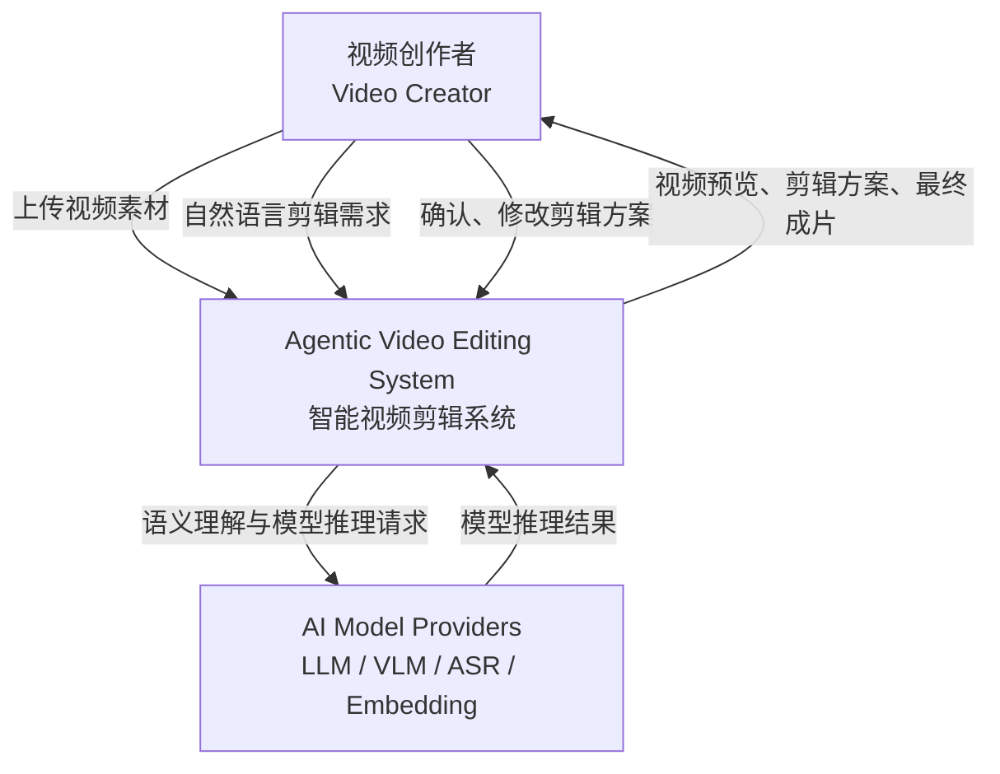
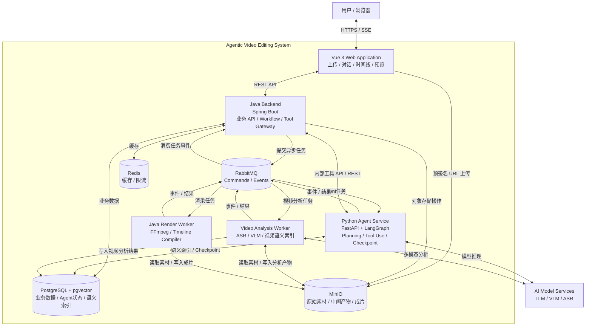
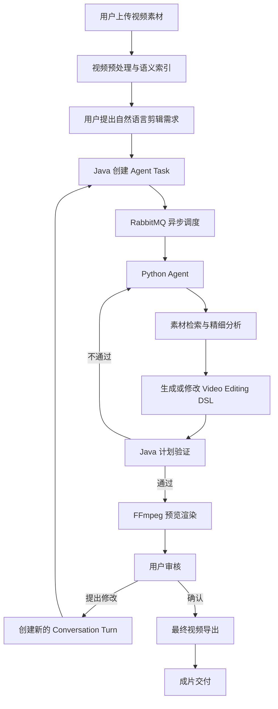

# Agentic Video Editing System — 系统总览与设计导航（预研版）

**项目名称：** Agent 驱动的智能视频剪辑系统  
**文档版本：** v0.2（按目录拆分，设计基线仍为 v0.1）<br>
**设计阶段：** 需求分析与系统架构预研  
**技术栈：** Vue 3 + Spring Boot + Python + LangGraph + RabbitMQ + PostgreSQL + MinIO + FFmpeg

## 仓库状态与目录导航

**当前状态：** 已建立目录与设计文档，三个工程尚未初始化，业务功能尚未实现或验证。本次文档拆分保留 v0.1 架构基线的设计内容；模块文档沿用原章节编号，便于追溯。根文档保留需求、架构、取舍、风险和里程碑，详细设计通过链接进入对应目录。

```text
AgenticVideo/
├── README.md                     # 需求、系统总览与设计导航
├── AGENTS.md                     # 仓库协作规范
├── frontend/
│   └── README.md                 # Vue 页面、工作台与 SSE
├── backend/
│   ├── README.md                 # Java 业务控制与业务模型
│   ├── api/README.md             # Public API 与 Internal Tool API
│   ├── timeline/README.md        # Edit Plan、Revision、DSL 与验证
│   └── rendering/README.md       # Render Job、Java Worker 与 FFmpeg
├── agent-service/
│   ├── README.md                 # Python 工程边界与导航
│   ├── api/README.md             # FastAPI 入口边界（路由待设计）
│   ├── agent/README.md           # Agent 决策循环与输出规范
│   ├── analysis/README.md        # 视频理解、片段模型与检索
│   ├── tools/README.md           # 工具注册、网关、预算与安全
│   └── workers/README.md         # Agent / Analysis Worker 入口规划
└── docs/
    ├── README.md                 # 跨模块设计索引
    ├── capacity/README.md        # 容量、成本与非功能需求
    ├── data-model/README.md      # 数据选型、所有权与实体关系
    ├── conversation/README.md    # 多轮对话、状态与取消协作
    ├── messaging/README.md      # 消息协议、拓扑与可靠性
    └── observability/README.md   # 指标、评测与 Trace
```

| 阅读目标 | 入口 |
|---|---|
| 用户需求、范围与限制 | 本文第 1 章 |
| 前端页面、上传、时间线与实时反馈 | [Frontend](frontend/README.md) |
| Java 业务状态、API、DSL 与渲染 | [Backend](backend/README.md) |
| Python 规划、视频理解、工具与 Worker | [Agent Service](agent-service/README.md) |
| 跨模块数据、协议、容量与评测 | [Docs](docs/README.md) |
| 总体架构、风险、技术取舍与开发顺序 | 本文第 5、7、8 章 |

## 运行与验证入口

仓库尚无构建配置、锁文件、启动脚本或 CI，因此没有可确认的安装、启动、构建和业务测试命令。各模块 README 记录设计依赖与已知限制，工程初始化时补充实际命令。

当前文档验证包括内容迁移核对、相对链接与路径、Markdown 结构和 JSON 示例检查；可在仓库根目录执行 `git diff --check` 检查差异格式。容量、成本、性能和故障恢复仍需后续实测。

## 0. 系统概述

### 0.1 项目定位

本项目旨在设计并实现一个基于大语言模型与多模态视频理解技术的智能视频剪辑系统。

用户可以上传一个长视频或多个短视频，通过自然语言与 Agent 进行多轮交互，由 Agent 理解视频内容与用户剪辑意图，自主检索、分析和选择素材，生成结构化的视频剪辑方案，并交由视频渲染引擎生成成片。

系统支持用户通过后续对话持续调整剪辑方案，实现从**素材理解、剪辑规划、工具执行、视频渲染到用户反馈**的完整闭环。

### 0.2 核心设计原则

系统采用 **Workflow + Agent 混合架构**。

| 组件 | 核心职责 |
|---|---|
| Vue 前端 | 用户交互、视频上传、对话、时间线展示与预览 |
| Java 后端 | 业务管理、工作流控制、任务调度、权限管理、视频渲染 |
| Python Agent Service | 剪辑意图理解、视频语义检索、自主规划、工具调用 |
| RabbitMQ | 跨服务异步任务与事件通信 |
| PostgreSQL | 业务数据、对话记录、剪辑方案及向量索引 |
| MinIO | 原始视频、关键帧、音频、中间产物和最终成片 |
| FFmpeg | 实际的视频裁切、拼接、转码、音频处理和渲染 |

系统遵循以下职责划分：

> **Java 管业务与流程，Python 管 Agent 决策，RabbitMQ 管异步解耦，Editing DSL 管剪辑状态，FFmpeg 管确定性执行。**

---

# 1. 澄清需求与范围

## 1.1 目标用户

初期目标用户为有基础视频剪辑需求、但不希望手动完成大量素材筛选和镜头编排的个人创作者。

典型用户包括：

- 短视频内容创作者。
- 直播、访谈和播客内容创作者。
- Vlog、旅行和生活记录用户。
- 需要从已有视频中提取精彩片段的用户。

第一版优先满足个人创作者需求，不以专业影视后期团队为主要目标。

## 1.2 核心业务场景

### 场景 A：长视频自动剪辑为多个短视频

**输入：**

用户上传一个较长的视频，例如 60 分钟的访谈或直播。

**自然语言指令：**

> 从这个视频中剪出三条适合短视频平台发布的精彩片段，每条控制在 30～60 秒，保留完整的语义上下文，并添加字幕。

**系统行为：**

1. 解析视频基础信息。
2. 提取音频、语音转录、关键帧和场景信息。
3. 建立带时间戳的视频语义索引。
4. Agent 根据用户要求检索候选片段。
5. 按需深入分析候选片段。
6. Agent 选择精彩内容并确定剪辑范围。
7. 生成结构化剪辑计划。
8. Java 验证计划并执行预览渲染。
9. 用户确认或提出修改。
10. 最终导出短视频。

**预期输出：**

多条符合用户指定数量、时长、画幅及内容要求的短视频。

### 场景 B：多个短视频编排为完整视频

**输入：**

用户上传多个视频素材，例如 20 段旅游视频。

**自然语言指令：**

> 把这些素材整理成一条两分钟的旅行 Vlog，开头使用最吸引人的画面，中间按照旅行过程展开，最后用日落镜头结尾。

**系统行为：**

1. 对多个视频进行并行分析。
2. 建立跨素材语义索引。
3. 提取人物、场景、动作、时间和素材质量信息。
4. Agent 根据用户要求设计叙事结构。
5. 检索并选择合适的镜头。
6. 规划镜头顺序、时长和转场。
7. 生成 Video Editing DSL。
8. Java 执行计划验证和视频渲染。
9. 用户通过自然语言继续修改。

**预期输出：**

一条具有基本叙事结构和镜头连续性的完整视频。

### 场景 C：多轮对话修改已有视频

**输入：**

用户已经获得初版剪辑结果。

**自然语言指令：**

> 把开头换成海边的镜头，第二段缩短五秒，结尾不要修改。

**系统行为：**

1. 恢复当前 Conversation Context。
2. 读取当前 Edit Plan 及其版本。
3. 识别用户希望修改的镜头。
4. 生成局部修改操作。
5. 验证是否违反“结尾不变”等约束。
6. 创建新的 Edit Plan Revision。
7. 重新渲染预览。

**预期输出：**

新版本的视频剪辑方案，而不是重新生成整个项目。

## 1.3 MVP 功能范围

建议将第一版范围限制为：

| 模块 | MVP 功能 | 优先级 |
|---|---|---|
| 用户系统 | 注册、登录、项目隔离 | P0 |
| 素材管理 | 上传、删除、查看、预览 | P0 |
| 视频分析 | 元数据提取、ASR、抽帧、场景切分 | P0 |
| 视频理解 | VLM 片段描述、语义索引 | P0 |
| Agent | 自然语言意图识别、工具调用、素材检索 | P0 |
| 剪辑规划 | 片段选择、排序、时间线生成 | P0 |
| 视频编辑 | 裁切、拼接、基础字幕、画幅调整 | P0 |
| 多轮对话 | 新建方案、修改方案、查询内容 | P0 |
| 状态管理 | Agent Task、Conversation、Plan Revision | P0 |
| 渲染 | 预览渲染、最终导出 | P0 |
| 实时反馈 | Agent 状态、任务进度、渲染进度 | P0 |
| 工具治理 | 参数验证、权限、预算、幂等、日志 | P0 |
| 用户确认 | 方案确认、修改、重新渲染 | P0 |
| 自动配乐 | 根据风格选择有授权的背景音乐 | P1 |
| 高级字幕 | 动态字幕效果、模板化字幕 | P1 |
| 主体跟踪 | 智能横屏转竖屏 | P1 |
| 镜头质量评价 | 画面清晰度、稳定性和视觉连续性 | P1 |
| 时间线可视化编辑 | 拖动、裁切、多轨道编辑 | P1 |
| 自动成片审查 | 多模态质量检查与修正建议 | P1 |

其中 P0 表示核心闭环必需功能，P1 表示后续增强功能。

### 1.4 明确不做什么

第一版不考虑：

| 不做的功能 | 原因 |
|---|---|
| 文生视频、图生视频 | 与基于已有素材的剪辑目标不同 |
| 专业级 NLE 全功能替代 | 开发成本过高 |
| 多人实时协同编辑 | 需要额外解决实时一致性 |
| 多 Agent 大规模协作 | 初期单 Agent 更容易验证 |
| 自训练基础视频理解模型 | 优先复用现有 VLM |
| 复杂影视特效 | 与 MVP 核心目标无关 |
| 自动发布到社交平台 | 涉及外部账号权限及平台 API |
| 无限制自主剪辑循环 | 成本与执行风险不可控 |
| 无授权素材自动获取 | 版权与安全风险 |

“流行短视频”在第一版中定义为**按照预先约定的短视频编辑标准生成内容**，而不是承诺能够预测或制造爆款。

## 1.5 系统约束

### 技术约束

- 前端使用 Vue 3 + TypeScript。
- 业务后端使用 Java + Spring Boot。
- Agent Service 使用 Python + FastAPI + LangGraph。
- Java 与 Python 之间的长任务使用 RabbitMQ。
- Python 调用 Java 的低延迟业务工具使用内部 HTTP API。
- Java 负责 Video Editing DSL 的权威存储与验证。
- FFmpeg 渲染集成在 Java 后端系统内，但允许独立部署 Render Worker。
- 视频文件存入 MinIO，消息队列不传输大文件。

### 产品约束

MVP 暂定：

| 约束 | 初始建议值 |
|---|---|
| 单个素材最大时长 | 120 分钟 |
| 单个素材最大大小 | 4 GB |
| 单项目最大素材数量 | 30 个 |
| 单项目累计素材时长 | 180 分钟 |
| 输出视频最大时长 | 10 分钟 |
| 默认导出格式 | MP4（H.264 + AAC） |
| 默认分辨率 | 1080p |
| 支持画幅 | 16:9、9:16 |
| 单会话活动写入任务 | 同一时间最多 1 个 |
| 同一计划的并发修改 | 乐观锁控制 |
| 高成本工具调用 | 必须受预算控制 |

这些是用于缩小 MVP 范围的建议限制，并非技术栈本身的能力上限。

---

# 2. 估算系统规模与非功能需求

完整的规模假设、Token 与存储估算、SLO、资源规划已移至 [容量规划](docs/capacity/README.md)。所有数值仍为设计假设与目标，未经过真实用户数据或压测验证。

---

# 3. 定义核心用例与 API 边界

## 3.1 核心业务用例

| ID | 用例 | 参与方 | 前置条件 | 结果 |
|---|---|---|---|---|
| UC01 | 创建视频项目 | 用户、Java | 已登录 | 创建 Project |
| UC02 | 上传视频素材 | 用户、Java、MinIO | 项目存在 | 素材上传成功 |
| UC03 | 视频自动分析 | Java、Python | 素材上传完成 | 生成语义索引 |
| UC04 | 创建视频剪辑方案 | 用户、Agent | 素材可用 | 创建 Edit Plan |
| UC05 | 长视频精彩片段提取 | Agent | 素材已分析 | 选择候选片段 |
| UC06 | 多素材叙事编排 | Agent | 素材已分析 | 生成完整时间线 |
| UC07 | 多轮修改剪辑方案 | 用户、Agent | 已存在 Edit Plan | 生成新 Revision |
| UC08 | 用户确认方案 | 用户、Java | 方案验证通过 | 确认指定版本 |
| UC09 | 渲染视频预览 | Java、FFmpeg | 方案合法 | 生成预览文件 |
| UC10 | 正式导出视频 | 用户、Java | 方案已确认 | 生成最终视频 |
| UC11 | 取消 Agent 任务 | 用户、Java、Python | 任务未终止 | 取消或标记取消 |
| UC12 | 查询任务状态 | 用户、Java | 项目访问权限有效 | 返回进度 |
| UC13 | 恢复历史剪辑版本 | 用户、Java | 存在历史版本 | 创建恢复后的新版本 |

## 3.2 接口设计导航

- [Public API 与 Internal Tool API](backend/api/README.md)：接口原则、上传流程、Conversation、Editing Plan、渲染与业务工具接口。
- [RabbitMQ 消息契约](docs/messaging/README.md)：消息类型、统一 Envelope 与异步可靠性。
- [前端交互与 SSE](frontend/README.md)：页面、工作台、实时通知与断线恢复。

---

# 4. 设计数据模型与数据库选型

跨服务选型、数据所有权与实体关系统一维护在 [数据模型](docs/data-model/README.md)。详细模型按维护职责拆分：

| 模型 | 设计入口 |
|---|---|
| Project、Asset、Conversation、Message、ConversationTurn、Agent Task | [Java 业务模型](backend/README.md) |
| Edit Plan、Edit Plan Revision、Video Editing DSL | [Timeline](backend/timeline/README.md) |
| Video Segment、Video Embedding、语义检索 | [Analysis](agent-service/analysis/README.md) |
| Render Job | [Rendering](backend/rendering/README.md) |
| Outbox、Inbox | [Messaging](docs/messaging/README.md) |

Java 仍是业务状态和剪辑计划的权威管理方；Python 管理分析派生数据和执行状态，不直接修改 Java 业务表。

---

# 5. 高层架构设计

本节采用 C4 Model 的思想，分别绘制：

- **System Context Diagram**：把系统当成一个黑盒，明确外部参与者与系统的关系。
- **Container Diagram**：打开系统黑盒，展示前端、后端服务、Agent、消息队列、数据库和渲染组件。

这里的 Container 指逻辑上可独立运行或部署的应用与数据存储组件，不等同于 Docker 容器。

## 5.1 System Context Diagram

这一层暂时不考虑 Java、Python 和 RabbitMQ 的内部实现。

只回答三个问题：

1. 谁使用系统？
2. 系统向外部提供什么能力？
3. 系统依赖哪些外部服务？



### 系统边界

**系统内部负责：**

- 用户与项目管理。
- 视频素材管理。
- 多轮对话。
- Agent 任务编排。
- 视频语义索引。
- 视频剪辑计划。
- 视频渲染。
- 工具治理和权限控制。

**系统外部依赖：**

- LLM 推理能力。
- VLM 视频或图像理解能力。
- ASR 语音识别能力。
- Embedding 模型。

这些 AI 能力既可以通过外部 API 提供，也可以由自部署模型提供。第一版不需要确定所有模型的最终部署方式。

## 5.2 Container Diagram

根据已经确定的技术栈，推荐如下架构。



### 5.2.1 各 Container 职责

| Container | 技术 | 职责 |
|---|---|---|
| Web Application | Vue 3 + TypeScript | 用户交互 |
| Java Backend | Spring Boot | 核心业务、API、主工作流 |
| Python Agent Service | FastAPI + LangGraph | Agent 决策与工具调用 |
| Video Analysis Worker | Python | ASR、VLM、视频索引 |
| Java Render Worker | Java + FFmpeg | 视频处理与导出 |
| RabbitMQ | RabbitMQ | 任务和事件传递 |
| PostgreSQL | PostgreSQL + pgvector | 数据持久化与语义检索 |
| MinIO | S3 Compatible Storage | 视频文件及产物存储 |
| Redis | Redis | 缓存及短期协调状态 |

### 5.2.2 重要部署说明

**Video Analysis Worker 不一定需要独立开发成第三个 Python 服务。**

第一版可以使用同一个 Python 代码仓库：

```text
agent-service/
├── api/
├── agent/
├── analysis/
├── tools/
└── workers/
```

通过不同的启动入口运行：

```text
Python Agent API
Python Agent Worker
Python Analysis Worker
```

这样既能复用代码，又能独立控制不同任务的并发和资源消耗。

同样，Render Worker 可以与 Java 后端放在同一个代码仓库中，只是在部署时独立运行。

所以系统在代码层面可以保持：

```text
frontend/
backend/
agent-service/
```

三个主要工程。

不必一开始拆分出大量微服务。

---

# 6. 关键组件详细设计

各组件的详细设计迁移到对应目录 README，原章节编号保留，正文在以下入口维护：

| 原章节 | 组件 | 设计入口 |
|---|---|---|
| 6.1 | Java Backend | [backend/README.md](backend/README.md) |
| 6.2 | Video Understanding | [agent-service/analysis/README.md](agent-service/analysis/README.md) |
| 6.3 | Python Agent | [agent-service/agent/README.md](agent-service/agent/README.md) |
| 6.4 | Tool Governance | [agent-service/tools/README.md](agent-service/tools/README.md) |
| 6.5 | Conversation & Memory | [docs/conversation/README.md](docs/conversation/README.md) |
| 6.6 | Video Editing DSL | [backend/timeline/README.md](backend/timeline/README.md) |
| 6.7 | RabbitMQ | [docs/messaging/README.md](docs/messaging/README.md) |
| 6.8 | Rendering | [backend/rendering/README.md](backend/rendering/README.md) |
| 6.9 | Vue | [frontend/README.md](frontend/README.md) |
| 6.10 | 可观测性与评测 | [docs/observability/README.md](docs/observability/README.md) |

---

# 7. 架构取舍、风险与未决问题

## 7.1 核心技术取舍

| 设计决策 | 选择 | 替代方案 | 主要原因 |
|---|---|---|---|
| 主后端 | Spring Boot | Python 全栈 | Java 负责稳定的业务管理与执行控制 |
| Agent 服务 | Python + LangGraph | Java Agent 框架 | Python 多模态与 Agent 生态更方便 |
| 服务通信 | RabbitMQ + REST | 全 REST / Kafka / gRPC | 兼顾异步长任务与低延迟工具调用 |
| 系统编排 | Java Workflow + Python Agent | 全自主 Agent | 限制高成本和不可逆操作 |
| Agent 架构 | 单 Agent | Multi-Agent | 简化状态与调试 |
| 数据库 | PostgreSQL + pgvector | MySQL + 专用向量库 | 减少初期组件数量 |
| 视频存储 | MinIO | 数据库存储大文件 | 视频更适合对象存储 |
| 渲染方案 | Java + FFmpeg | Python MoviePy / 完全前端渲染 | 渲染结果可控，方便服务端管理 |
| 剪辑状态 | Versioned DSL | 自然语言描述 / FFmpeg 命令 | 可校验、可修改、可回滚 |
| 实时通信 | SSE | WebSocket | 当前以服务端单向通知为主 |
| 前端上传 | 预签名直传 | 文件全部经过 Java | 减轻业务服务的带宽与内存压力 |

### 7.1.1 为什么选择 RabbitMQ，而不是 Kafka？

当前系统的异步通信以任务命令和业务事件为主：

- 创建视频分析任务。
- 创建 Agent Task。
- 创建渲染任务。
- 接收任务完成或失败事件。

这些任务通常要求可靠投递、消费确认、有限重试和死信处理。

RabbitMQ 比较适合该阶段的需求。

Kafka 更值得考虑的场景包括大规模事件流、长期事件重放、多个独立消费者持续处理高吞吐事件数据等。

对于第一版视频剪辑系统，没有必要提前承担 Kafka 集群及事件流架构的复杂度。

### 7.1.2 为什么不把所有业务 Workflow 放到 LangGraph？

LangGraph 适合 Agent 的动态决策、工具调用、线程状态和可恢复执行。

但用户管理、上传、素材生命周期、用户确认、版本管理和视频渲染都是明确的业务操作。

这些应当由 Java 进行最终控制。

否则 Python Agent Service 容易演变成整个系统事实上的业务后端，违背最初的服务边界。

### 7.1.3 为什么不让 Agent 直接输出 FFmpeg 命令？

因为：

- 无法稳定验证所有操作。
- 不利于版本管理。
- 难以支持多轮局部修改。
- 容易产生不安全的执行行为。
- 不利于支持可视化时间线。

因此引入 Video Editing DSL。

这会增加前期设计成本，但能明显降低后续扩展复杂度。

---

## 7.2 主要技术风险

### 风险清单

| 风险 | 影响 | 优先级 | 应对措施 |
|---|---|---|---|
| VLM 对视频理解不准确 | 选错镜头、事件定位错误 | 高 | 分层分析、局部复查、保存证据 |
| 精彩片段判断主观性强 | 用户不满意 | 高 | 定义评价标准、加入人工反馈 |
| 长视频分析成本过高 | Token 和计算资源失控 | 高 | 粗细两阶段分析、缓存、预算 |
| Agent 反复调用工具 | 延迟增加、成本增加 | 高 | Tool Budget、步数限制 |
| Agent 产生非法剪辑方案 | 渲染失败 | 高 | Editing DSL Validator |
| 多轮对话状态混乱 | 误修改用户视频 | 高 | Java 状态权威、版本控制 |
| RabbitMQ 重复消费 | 重复任务、重复渲染 | 高 | Outbox、Inbox、幂等键 |
| 服务崩溃导致任务丢失 | 无法恢复 | 高 | Checkpoint、持久化任务、租约 |
| FFmpeg 资源占用过大 | API 性能下降 | 高 | 独立 Worker、资源限制 |
| ASR / OCR 提示注入 | Agent 被素材内容误导 | 高 | 不可信数据隔离、工具权限 |
| 用户视频数据泄露 | 隐私与安全问题 | 高 | 私有对象存储、授权访问、隔离 |
| 多素材叙事不连贯 | 最终视频质量差 | 中高 | Storyboard、镜头连续性检查 |
| 音视频不同步 | 成片无法使用 | 中高 | 时间基处理、同步质量检测 |
| 第三方模型不稳定 | 任务失败或成本波动 | 中 | 超时、重试、模型适配层 |
| 缺乏真实评测数据 | 难判断 Agent 是否有效 | 中高 | 建立固定测试集和人工评价流程 |

### 7.2.1 最高风险：视频理解与时间定位

整个系统的价值首先取决于 Agent 能否找到用户需要的视频片段。

如果模型只能大致描述视频，却无法可靠定位起止时间，那么后续剪辑规划再复杂，也很难生成高质量成片。

因此第一阶段应重点验证：

> 给定自然语言描述，系统能否从长视频中检索到正确的内容，并返回足够准确的时间范围？

建议准备不同类型的测试视频，记录人工标注的目标片段。

通过 Temporal IoU、定位误差和人工评价验证。

### 7.2.2 第二个高风险：Agent 是否真正优于固定 Workflow？

需要防止整个项目只是把 LLM 包装成所谓的 Agent。

建议建立两组基线。

**Baseline A：固定 Workflow**

```text
固定视频分析
    ↓
片段评分
    ↓
一次 LLM 生成剪辑方案
    ↓
渲染
```

**System B：Hybrid Agent**

```text
基础视频分析
    ↓
Agent 自主检索
    ↓
按需精细理解
    ↓
动态剪辑规划
    ↓
验证与局部修正
    ↓
渲染
```

在相同输入和相近预算下，比较：

| 评价维度 | 主要指标 |
|---|---|
| 内容定位 | Recall@K、Temporal IoU |
| 剪辑方案 | 约束满足率、有效方案比例 |
| 任务效果 | Task Success Rate |
| 用户体验 | 人工满意度、人工修改次数 |
| 执行成本 | Token、模型费用、工具调用次数 |
| 执行效率 | 任务完成时间 |
| 稳定性 | 失败率、恢复成功率 |

只有证明自主检索与规划能带来实际收益，Agent 架构的复杂性才有充分理由。

---

## 7.3 尚未解决的问题

目前最重要的未决问题如下。

| 问题 | 当前推荐方案 | 需要验证的内容 |
|---|---|---|
| 第一版视频类型 | 优先访谈、播客、知识分享 | 是否需要同时支持视觉主导的游戏和 Vlog |
| LLM 选择 | 模型适配层，先使用成熟模型 | 成本、工具调用能力、稳定性 |
| VLM 选择 | 优先成熟的视频理解模型 | 长视频效果、时间定位质量 |
| 模型部署 | 初期 API，保留本地部署能力 | 成本与 GPU 资源 |
| 素材语义索引 | PostgreSQL + pgvector | 检索效果和规模上限 |
| 视频精细理解 | Agent 按需调用 | 分析收益是否覆盖成本 |
| Editing DSL | 自定义版本化 JSON Schema | 是否足以支持未来多轨道剪辑 |
| 预览渲染 | FFmpeg | 复杂字幕和动画是否需要其他渲染技术 |
| Agent 记忆 | Checkpoint + 结构化项目上下文 | 长会话是否需要更复杂记忆机制 |
| 视频质量评估 | 规则 + VLM + 人工评价 | 自动评价与人工评价的一致性 |
| Agent 并发 | 同一会话写任务串行 | 是否需要跨会话操作同一计划的锁 |
| 用户审批 | 正式导出前确认 | 哪些高成本操作还需要审批 |
| 素材保留 | 建立生命周期策略 | 保留期限与存储成本 |
| 失败补偿 | 状态机 + 幂等 + 清理任务 | 跨服务异常下的恢复效果 |

这些问题不必全部在开发前解决。

建议优先通过最小实验验证高风险假设，再根据真实结果做决策。

---

## 7.4 推荐开发里程碑

### Milestone 1：完成确定性视频编辑闭环

先不接入复杂 Agent。

完成：

- Vue 上传视频。
- Java 保存素材。
- MinIO 对象存储。
- Video Editing DSL。
- Java Timeline Compiler。
- FFmpeg 渲染。
- 预览和最终导出。

**验收：**

输入一份合法的 Editing DSL，能够稳定生成对应的视频。

### Milestone 2：完成视频理解与语义检索

完成：

- 视频自动分析。
- ASR。
- 场景切分与关键帧提取。
- VLM 视频描述。
- 视频语义索引。
- 自然语言检索片段。

**验收：**

能够从指定视频中检索用户描述的内容，并返回时间范围。

### Milestone 3：实现独立 Agent Service

完成：

- FastAPI。
- LangGraph。
- Tool Registry。
- Tool Gateway。
- Java Internal Tool API。
- 视频剪辑规划 Agent。

**验收：**

用户输入自然语言，Agent 能检索素材、生成 DSL，并通过 Java 的验证和渲染得到视频。

### Milestone 4：接入 RabbitMQ 与持久化任务

完成：

- Agent Task 消息。
- 异步分析与渲染。
- Outbox / Inbox。
- 幂等消费。
- 状态事件。
- SSE。
- Checkpoint。
- 失败恢复。

**验收：**

在 Java、Python 或 Worker 重启后，任务不会静默丢失，也不会因为消息重复而产生重复业务结果。

### Milestone 5：实现多轮对话剪辑

完成：

- Conversation。
- Agent Context Builder。
- 意图路由。
- Patch-Based Editing。
- Plan Revision。
- 用户确认。
- 取消与恢复。

**验收：**

用户能够连续修改同一条视频，保留历史版本，不会出现旧任务覆盖新版本的情况。

### Milestone 6：实现两个完整业务场景

完成：

**A. 长视频提取短视频**

- Highlight Retrieval。
- Highlight Ranking。
- 精确片段定位。
- 多条短视频生成。

**B. 多素材编排**

- 跨素材检索。
- Storyboard Planning。
- 镜头排序。
- 基础叙事结构。
- 视频时间线生成。

**验收：**

两种场景都能够在用户少量交互下形成可播放成片，并允许后续多轮调整。

### Milestone 7：完善评测与工程可靠性

完成：

- 固定测试素材集。
- Agent 与 Workflow 对照实验。
- 工具治理指标。
- 成片质量评价。
- 性能压测。
- 成本监控。
- 故障注入测试。

**验收：**

系统能够用可重复的实验说明：功能是否正确、Agent 是否有效、成本是否可接受，以及故障后是否可以恢复。

---

# 8. 最终设计结论

虽然设计过程按照前面的七个步骤展开，但最终可以归纳为五项核心架构决策。

| 架构领域 | 最终选择 |
|---|---|
| 系统形式 | Java 模块化单体 + 独立 Python Agent Service |
| 智能编排 | 外层业务 Workflow + 内层 Agent Loop |
| 服务通信 | RabbitMQ 异步任务 + REST 工具调用 + SSE 推送 |
| 状态管理 | Java 业务状态 + Python Checkpoint + Versioned Editing DSL |
| 视频执行 | Java RenderService + FFmpeg Worker |

整个系统最重要的设计不是让 Agent 能够调用尽可能多的工具，而是建立一个可验证、可恢复、可持续修改的视频制作过程。

最终业务闭环为：



## 关键工程原则

**第一，业务状态与 Agent 状态解耦。** Java 是项目、用户、对话、剪辑计划和渲染任务的权威业务系统；Python 负责推理与执行状态。

**第二，Agent 决策与确定性执行解耦。** Agent 负责选择素材和规划剪辑，Java 负责验证并执行剪辑方案。

**第三，长任务与实时工具调用解耦。** RabbitMQ 用于异步任务与事件；REST 用于需要立即返回结果的工具调用。

**第四，多轮对话与剪辑状态解耦。** Conversation 保存交互历史，而 Video Editing DSL 保存真正的编辑状态。Agent 不能通过对话历史猜测和覆盖当前计划。

**第五，智能能力与基础工程能力分开验证。** 先保证视频可以稳定裁切、拼接和渲染，再证明 Agent 自主检索与规划能够提高剪辑效果。

### 下一步最值得深入设计的部分

按照当前架构，我建议下一阶段优先确定以下三个技术规范：

1. **Video Editing DSL Specification v1**：定义 Clip、Track、Timeline、Transition、Patch Operation、Revision 和 Validator 的完整协议。
2. **Conversation & Agent Task Protocol v1**：定义多轮对话、异步消息、任务状态、取消、用户确认和恢复机制。
3. **Agent Tool Specification v1**：定义工具输入输出 Schema、权限等级、预算策略、调用结果与错误恢复规范。

这三个规范确定以后，Vue、Java 后端和 Python Agent Service 就能够按照明确的接口边界分别开发，而不必在实现过程中频繁调整底层架构。

**整体而言，这套设计适合作为项目的 v0.1 系统架构基线。下一阶段应该通过关键技术验证和 MVP 实现来修正容量假设、工具接口及视频理解策略，而不是继续增加不必要的架构复杂度。**
