# Agentic Video Editing System — 系统设计文档（预研版）

**项目名称：** Agent 驱动的智能视频剪辑系统  
**文档版本：** v0.1  
**设计阶段：** 需求分析与系统架构预研  
**技术栈：** Vue 3 + Spring Boot + Python + LangGraph + RabbitMQ + PostgreSQL + MinIO + FFmpeg

## 0. 系统概述

### 0.1 项目定位

本项目旨在设计并实现一个基于大语言模型与多模态视频理解技术的智能视频剪辑系统。

用户可以上传一个长视频或多个短视频，通过自然语言与 Agent 进行多轮交互，由 Agent 理解视频内容与用户剪辑意图，自主检索、分析和选择素材，生成结构化的视频剪辑方案，并交由视频渲染引擎生成成片。

系统支持用户通过后续对话持续调整剪辑方案，实现从**素材理解、剪辑规划、工具执行、视频渲染到用户反馈**的完整闭环。

### 0.2 核心设计原则

系统采用 **Workflow + Agent 混合架构**。

| 组件 | 核心职责 |
|---|---|
| Vue 前端 | 用户交互、视频上传、对话、时间线展示与预览 |
| Java 后端 | 业务管理、工作流控制、任务调度、权限管理、视频渲染 |
| Python Agent Service | 剪辑意图理解、视频语义检索、自主规划、工具调用 |
| RabbitMQ | 跨服务异步任务与事件通信 |
| PostgreSQL | 业务数据、对话记录、剪辑方案及向量索引 |
| MinIO | 原始视频、关键帧、音频、中间产物和最终成片 |
| FFmpeg | 实际的视频裁切、拼接、转码、音频处理和渲染 |

系统遵循以下职责划分：

> **Java 管业务与流程，Python 管 Agent 决策，RabbitMQ 管异步解耦，Editing DSL 管剪辑状态，FFmpeg 管确定性执行。**

---

# 1. 澄清需求与范围

## 1.1 目标用户

初期目标用户为有基础视频剪辑需求、但不希望手动完成大量素材筛选和镜头编排的个人创作者。

典型用户包括：

- 短视频内容创作者。
- 直播、访谈和播客内容创作者。
- Vlog、旅行和生活记录用户。
- 需要从已有视频中提取精彩片段的用户。

第一版优先满足个人创作者需求，不以专业影视后期团队为主要目标。

## 1.2 核心业务场景

### 场景 A：长视频自动剪辑为多个短视频

**输入：**

用户上传一个较长的视频，例如 60 分钟的访谈或直播。

**自然语言指令：**

> 从这个视频中剪出三条适合短视频平台发布的精彩片段，每条控制在 30～60 秒，保留完整的语义上下文，并添加字幕。

**系统行为：**

1. 解析视频基础信息。
2. 提取音频、语音转录、关键帧和场景信息。
3. 建立带时间戳的视频语义索引。
4. Agent 根据用户要求检索候选片段。
5. 按需深入分析候选片段。
6. Agent 选择精彩内容并确定剪辑范围。
7. 生成结构化剪辑计划。
8. Java 验证计划并执行预览渲染。
9. 用户确认或提出修改。
10. 最终导出短视频。

**预期输出：**

多条符合用户指定数量、时长、画幅及内容要求的短视频。

### 场景 B：多个短视频编排为完整视频

**输入：**

用户上传多个视频素材，例如 20 段旅游视频。

**自然语言指令：**

> 把这些素材整理成一条两分钟的旅行 Vlog，开头使用最吸引人的画面，中间按照旅行过程展开，最后用日落镜头结尾。

**系统行为：**

1. 对多个视频进行并行分析。
2. 建立跨素材语义索引。
3. 提取人物、场景、动作、时间和素材质量信息。
4. Agent 根据用户要求设计叙事结构。
5. 检索并选择合适的镜头。
6. 规划镜头顺序、时长和转场。
7. 生成 Video Editing DSL。
8. Java 执行计划验证和视频渲染。
9. 用户通过自然语言继续修改。

**预期输出：**

一条具有基本叙事结构和镜头连续性的完整视频。

### 场景 C：多轮对话修改已有视频

**输入：**

用户已经获得初版剪辑结果。

**自然语言指令：**

> 把开头换成海边的镜头，第二段缩短五秒，结尾不要修改。

**系统行为：**

1. 恢复当前 Conversation Context。
2. 读取当前 Edit Plan 及其版本。
3. 识别用户希望修改的镜头。
4. 生成局部修改操作。
5. 验证是否违反“结尾不变”等约束。
6. 创建新的 Edit Plan Revision。
7. 重新渲染预览。

**预期输出：**

新版本的视频剪辑方案，而不是重新生成整个项目。

## 1.3 MVP 功能范围

建议将第一版范围限制为：

| 模块 | MVP 功能 | 优先级 |
|---|---|---|
| 用户系统 | 注册、登录、项目隔离 | P0 |
| 素材管理 | 上传、删除、查看、预览 | P0 |
| 视频分析 | 元数据提取、ASR、抽帧、场景切分 | P0 |
| 视频理解 | VLM 片段描述、语义索引 | P0 |
| Agent | 自然语言意图识别、工具调用、素材检索 | P0 |
| 剪辑规划 | 片段选择、排序、时间线生成 | P0 |
| 视频编辑 | 裁切、拼接、基础字幕、画幅调整 | P0 |
| 多轮对话 | 新建方案、修改方案、查询内容 | P0 |
| 状态管理 | Agent Task、Conversation、Plan Revision | P0 |
| 渲染 | 预览渲染、最终导出 | P0 |
| 实时反馈 | Agent 状态、任务进度、渲染进度 | P0 |
| 工具治理 | 参数验证、权限、预算、幂等、日志 | P0 |
| 用户确认 | 方案确认、修改、重新渲染 | P0 |
| 自动配乐 | 根据风格选择有授权的背景音乐 | P1 |
| 高级字幕 | 动态字幕效果、模板化字幕 | P1 |
| 主体跟踪 | 智能横屏转竖屏 | P1 |
| 镜头质量评价 | 画面清晰度、稳定性和视觉连续性 | P1 |
| 时间线可视化编辑 | 拖动、裁切、多轨道编辑 | P1 |
| 自动成片审查 | 多模态质量检查与修正建议 | P1 |

其中 P0 表示核心闭环必需功能，P1 表示后续增强功能。

### 1.4 明确不做什么

第一版不考虑：

| 不做的功能 | 原因 |
|---|---|
| 文生视频、图生视频 | 与基于已有素材的剪辑目标不同 |
| 专业级 NLE 全功能替代 | 开发成本过高 |
| 多人实时协同编辑 | 需要额外解决实时一致性 |
| 多 Agent 大规模协作 | 初期单 Agent 更容易验证 |
| 自训练基础视频理解模型 | 优先复用现有 VLM |
| 复杂影视特效 | 与 MVP 核心目标无关 |
| 自动发布到社交平台 | 涉及外部账号权限及平台 API |
| 无限制自主剪辑循环 | 成本与执行风险不可控 |
| 无授权素材自动获取 | 版权与安全风险 |

“流行短视频”在第一版中定义为**按照预先约定的短视频编辑标准生成内容**，而不是承诺能够预测或制造爆款。

## 1.5 系统约束

### 技术约束

- 前端使用 Vue 3 + TypeScript。
- 业务后端使用 Java + Spring Boot。
- Agent Service 使用 Python + FastAPI + LangGraph。
- Java 与 Python 之间的长任务使用 RabbitMQ。
- Python 调用 Java 的低延迟业务工具使用内部 HTTP API。
- Java 负责 Video Editing DSL 的权威存储与验证。
- FFmpeg 渲染集成在 Java 后端系统内，但允许独立部署 Render Worker。
- 视频文件存入 MinIO，消息队列不传输大文件。

### 产品约束

MVP 暂定：

| 约束 | 初始建议值 |
|---|---|
| 单个素材最大时长 | 120 分钟 |
| 单个素材最大大小 | 4 GB |
| 单项目最大素材数量 | 30 个 |
| 单项目累计素材时长 | 180 分钟 |
| 输出视频最大时长 | 10 分钟 |
| 默认导出格式 | MP4（H.264 + AAC） |
| 默认分辨率 | 1080p |
| 支持画幅 | 16:9、9:16 |
| 单会话活动写入任务 | 同一时间最多 1 个 |
| 同一计划的并发修改 | 乐观锁控制 |
| 高成本工具调用 | 必须受预算控制 |

这些是用于缩小 MVP 范围的建议限制，并非技术栈本身的能力上限。

---

# 2. 估算系统规模与非功能需求

这里需要先明确：

**目前没有真实用户数据和压测数据，因此下面采用容量规划假设，而不是声称系统已经达到这些性能指标。**

## 2.1 初始业务规模假设

假设系统处于早期测试阶段：

| 指标 | 假设值 |
|---|---:|
| DAU | 300 |
| 每日新增剪辑项目 | 40 |
| 每项目平均素材数量 | 4 |
| 每项目平均素材总时长 | 20 分钟 |
| 每项目平均对话轮数 | 6 |
| 每项目平均渲染任务数 | 2 |
| 单日 API 请求量 | 9,000 |
| 峰值流量系数 | 10 倍 |
| 原始视频平均码率 | 8 Mbps |

由此可以推导出初步容量。

### 2.2 API QPS

假设每日 9,000 次普通 API 请求：

\[
QPS_{avg}=\frac{9000}{86400}\approx0.104
\]

峰值按照平均流量的 10 倍计算：

\[
QPS_{peak}\approx1.04
\]

因此，在此假设下：

| 指标 | 估算结果 |
|---|---:|
| 平均业务 API QPS | 0.10 |
| 峰值业务 API QPS | 1.04 |
| 每日新建 Agent 对话任务 | 240 |
| 每日素材分析任务 | 160 |
| 每日视频渲染任务 | 80 |

这里的普通 API QPS 不包含上传文件的数据传输、SSE 长连接、消息队列内部事件和 Agent 工具请求。

由于早期实际流量可能高度集中，建议把 **10 QPS 的混合业务负载**作为初步压测起点，而不是只测试 1 QPS。

但视频系统的主要瓶颈通常不是普通 HTTP QPS，而是：

- 视频上传带宽。
- 视频解码与转码计算量。
- VLM 推理吞吐。
- 任务队列等待时间。
- 并发渲染能力。

### 2.3 视频存储规模

每日新增素材总时长：

\[
40 \times 20 = 800\text{ 分钟}
\]

按照平均码率 8 Mbps 估算：

\[
Storage_{day}
=\frac{800\times60\times8}{8}
=48000\text{ MB}
\]

即约 **48 GB/天**。

| 指标 | 估算 |
|---|---:|
| 每日原始视频 | 48 GB |
| 30 天原始视频 | 1.44 TB |
| 包含预览、关键帧、音频和成片 | 暂按原始素材的 2～3 倍规划 |
| 30 天总对象存储 | 约 2.9～4.3 TB |

以上采用十进制 GB/TB，未计入对象存储副本、备份等额外开销。

实际还要注意：

- 不应为每次剪辑计划修改复制一份源视频。
- 原始素材可以在不同剪辑方案之间复用。
- 临时帧和中间转码文件应设置清理策略。
- 对不再需要的预览版本设置保留期限。
- 删除项目时需要协调数据库记录与对象存储清理。

上传建议采用预签名 URL 与分片上传，让浏览器直接访问对象存储。S3 兼容接口支持预签名上传；分片上传允许失败后只重传相应分片。[AWS Documentation](https://docs.aws.amazon.com/AmazonS3/latest/userguide/using-presigned-url.html?utm_source=chatgpt.com)

### 2.4 LLM Token 消耗估算

Token 消耗需要分为两类：

**第一类：文本 Agent Token。**

包括：

- 理解用户剪辑意图。
- 选择工具。
- 分析工具返回结果。
- 生成剪辑计划。
- 根据用户反馈修改计划。

假设每一轮用户对话平均需要：

| 指标 | 假设 |
|---|---:|
| LLM 调用次数 | 3 |
| 每次平均输入 Token | 3,000 |
| 每次平均输出 Token | 800 |
| 每轮输入 Token | 9,000 |
| 每轮输出 Token | 2,400 |

每日对话轮数：

\[
40 \times 6 = 240
\]

则每日消耗约：

\[
Input=240\times9000=2160000
\]

\[
Output=240\times2400=576000
\]

| 指标 | 每日 | 30 天 |
|---|---:|---:|
| 输入 Token | 216 万 | 6,480 万 |
| 输出 Token | 57.6 万 | 1,728 万 |

这是文本 Agent 的粗略预算，不包括视觉输入、Embedding、ASR，以及模型的额外计费维度。

**第二类：视频理解成本。**

建议采用“粗粒度索引 + 候选片段精细分析”的两阶段策略。

假设：

- 粗粒度分析每 15 秒采样 1 帧。
- 每个项目对 4 个候选片段进行精细分析。
- 每个候选片段平均分析 30 秒。
- 精细分析采样率为 2 FPS。

则：

| 视频分析指标 | 每日估算 |
|---|---:|
| ASR 处理音频 | 800 分钟 |
| 粗粒度分析图像 | 3,200 帧 |
| 精细分析图像 | 9,600 帧 |
| 合计视觉输入 | 12,800 帧 |

注意，视频帧不能简单按固定文本 Token 数折算。不同 VLM 的图像分辨率、视频预处理、视觉 Token 化和计费策略可能不同。

因此，建议建立独立的模型消耗记录：

```text
ModelUsage
├── text_input_tokens
├── text_output_tokens
├── cached_input_tokens
├── image_count
├── analyzed_video_seconds
├── audio_seconds
├── model_name
├── model_version
├── estimated_cost
└── actual_cost
```

实际预算计算：

\[
Cost_{total}
=
Cost_{LLM}
+
Cost_{VLM}
+
Cost_{ASR}
+
Cost_{Embedding}
+
Cost_{Rendering}
+
Cost_{Storage}
\]

其中，具体单价需要根据最终选择的模型和部署方式确定。

### 2.5 P99 与响应时间目标

**必须区分同步接口延迟与异步任务完成时间。**

例如用户提交剪辑任务后，Java 不应该等待 Python Agent 完整执行。

推荐返回：

```http
HTTP/1.1 202 Accepted
```

然后通过 SSE 推送任务状态。

初步 SLO 如下：

| 操作 | 目标 | 统计口径 |
|---|---|---|
| 普通业务数据读取 | P99 < 500 ms | 不包含视频文件传输 |
| 发送对话消息并创建任务 | P99 < 800 ms | 返回任务 ID |
| 查询剪辑计划 | P99 < 500 ms | 常规大小的计划 |
| 提交局部剪辑修改 | P99 < 1 s | 不包含模型推理 |
| SSE 接收任务创建确认 | P99 < 2 s | 从任务提交成功到前端收到事件 |
| 语义检索 | P95 < 2 s | 已完成索引的素材 |
| 已索引素材生成初步剪辑方案 | P95 < 120 s | 初始性能目标 |
| 60 秒、720p 视频预览渲染 | P95 < 180 s | 基准素材及指定硬件环境 |

上述指标属于设计目标，需要通过后续测试验证，尤其是涉及 VLM 和 FFmpeg 的任务。

长视频首次分析可能持续数分钟甚至更长，应提供任务进度，而非把它当成短时 HTTP 请求。

### 2.6 容量规划结论

初期建议：

| 资源 | 起步方案 |
|---|---|
| Java API | 1 个实例 |
| Python Agent API / Consumer | 1 个逻辑服务，API 和执行 Worker 可分进程 |
| 视频分析 Worker | 1～2 个，按实际模型吞吐调整 |
| 渲染 Worker | 1～2 个，并发数受限 |
| PostgreSQL | 1 个实例，按 Schema 分离数据所有权 |
| RabbitMQ | 初期单实例，生产按可靠性要求升级 |
| MinIO | 1 套对象存储 |
| Redis | 缓存、限流和短期状态 |

**以上是建议部署形态，不意味着这些实例数已经能够满足全部 SLO。**

后续应分别对 API、视频分析和渲染进行压测，而不是用一个整体 QPS 指标描述系统容量。

---

# 3. 定义核心用例与 API 边界

## 3.1 核心业务用例

| ID | 用例 | 参与方 | 前置条件 | 结果 |
|---|---|---|---|---|
| UC01 | 创建视频项目 | 用户、Java | 已登录 | 创建 Project |
| UC02 | 上传视频素材 | 用户、Java、MinIO | 项目存在 | 素材上传成功 |
| UC03 | 视频自动分析 | Java、Python | 素材上传完成 | 生成语义索引 |
| UC04 | 创建视频剪辑方案 | 用户、Agent | 素材可用 | 创建 Edit Plan |
| UC05 | 长视频精彩片段提取 | Agent | 素材已分析 | 选择候选片段 |
| UC06 | 多素材叙事编排 | Agent | 素材已分析 | 生成完整时间线 |
| UC07 | 多轮修改剪辑方案 | 用户、Agent | 已存在 Edit Plan | 生成新 Revision |
| UC08 | 用户确认方案 | 用户、Java | 方案验证通过 | 确认指定版本 |
| UC09 | 渲染视频预览 | Java、FFmpeg | 方案合法 | 生成预览文件 |
| UC10 | 正式导出视频 | 用户、Java | 方案已确认 | 生成最终视频 |
| UC11 | 取消 Agent 任务 | 用户、Java、Python | 任务未终止 | 取消或标记取消 |
| UC12 | 查询任务状态 | 用户、Java | 项目访问权限有效 | 返回进度 |
| UC13 | 恢复历史剪辑版本 | 用户、Java | 存在历史版本 | 创建恢复后的新版本 |

## 3.2 API 设计原则

采用三种接口：

**Public API**

面向 Vue 前端，提供业务操作。

**Internal Tool API**

面向 Python Agent，由 Java 实现并进行权限和参数校验。

**Async Message Contract**

用于 Java 与 Python 之间的长任务提交、完成事件和状态同步。

API 路径使用 `/api/v1` 进行版本管理。

消息协议独立使用 `schema_version`。

### 3.3 项目与素材 API

| Method | Endpoint | 功能 |
|---|---|---|
| POST | `/api/v1/projects` | 创建项目 |
| GET | `/api/v1/projects/{id}` | 查询项目 |
| GET | `/api/v1/projects/{id}/assets` | 查询项目素材 |
| POST | `/api/v1/projects/{id}/uploads/init` | 初始化上传 |
| POST | `/api/v1/uploads/{uploadId}/complete` | 完成上传 |
| GET | `/api/v1/assets/{id}` | 查询素材信息 |
| GET | `/api/v1/assets/{id}/analysis` | 查询分析状态 |
| POST | `/api/v1/assets/{id}/analysis/retry` | 重试失败的分析任务 |
| DELETE | `/api/v1/assets/{id}` | 删除素材，需检查引用关系 |

上传流程：

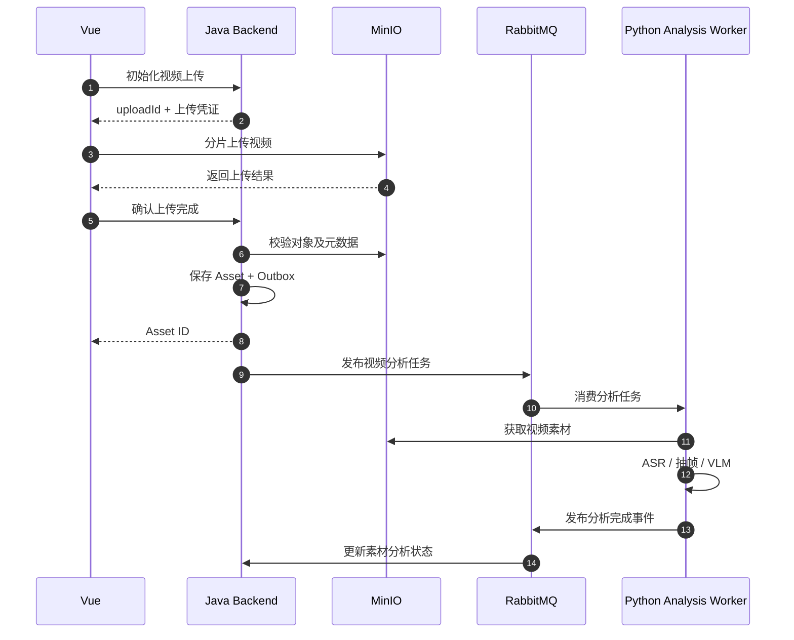

Java 在上传完成时需要检查对象大小、校验和、文件格式及访问权限，不能仅相信前端传递的“上传成功”标志。

## 3.4 Conversation API

这是支持多轮对话的核心接口。

| Method | Endpoint | 功能 |
|---|---|---|
| POST | `/api/v1/projects/{id}/conversations` | 创建会话 |
| GET | `/api/v1/conversations/{id}` | 获取会话 |
| GET | `/api/v1/conversations/{id}/messages` | 分页获取历史消息 |
| POST | `/api/v1/conversations/{id}/messages` | 发送用户消息 |
| GET | `/api/v1/conversations/{id}/events` | SSE 事件流 |
| GET | `/api/v1/agent-tasks/{id}` | 查询 Agent 任务 |
| POST | `/api/v1/agent-tasks/{id}/cancel` | 请求取消任务 |

例如，用户发送：

```http
POST /api/v1/conversations/conv_001/messages
```

```json
{
  "client_message_id": "client_msg_001",
  "content": "把第一个镜头缩短五秒，结尾不要修改",
  "references": {
    "plan_id": "plan_001",
    "expected_revision": 2
  }
}
```

其中：

- `client_message_id` 用于防止网络重试导致重复创建消息。
- `plan_id` 指向当前用户正在编辑的剪辑方案。
- `expected_revision` 用于检测方案版本变化。

Java 返回：

```json
{
  "message_id": "msg_003",
  "turn_id": "turn_003",
  "task_id": "task_003",
  "status": "QUEUED"
}
```

HTTP 状态码为 `202 Accepted`。

**关键约束：一个 Message 不一定对应一个独立的 Agent 执行任务。**

例如“撤销上一次修改”可以由 Java 直接执行，而“换一个更精彩的开头”可能需要运行完整 Agent Loop。

因此，是否创建 Agent Task 应由业务路由决定。

## 3.5 Editing Plan API

| Method | Endpoint | 功能 |
|---|---|---|
| GET | `/api/v1/projects/{id}/edit-plans` | 查询剪辑方案 |
| GET | `/api/v1/edit-plans/{id}` | 获取当前方案 |
| GET | `/api/v1/edit-plans/{id}/revisions` | 获取版本历史 |
| GET | `/api/v1/edit-plans/{id}/revisions/{rev}` | 查询指定版本 |
| PATCH | `/api/v1/edit-plans/{id}` | 修改剪辑方案 |
| POST | `/api/v1/edit-plans/{id}/validate` | 验证剪辑计划 |
| POST | `/api/v1/edit-plans/{id}/approve` | 确认指定版本 |
| POST | `/api/v1/edit-plans/{id}/restore` | 根据历史版本创建新版本 |

修改接口使用乐观锁。

例如：

```http
PATCH /api/v1/edit-plans/plan_001
If-Match: "revision-2"
```

如果当前版本已经是 `revision-3`，返回：

```http
409 Conflict
```

```json
{
  "code": "EDIT_PLAN_VERSION_CONFLICT",
  "expected_revision": 2,
  "current_revision": 3
}
```

这样可以防止用户与 Agent 同时编辑时产生覆盖。

## 3.6 渲染 API

| Method | Endpoint | 功能 |
|---|---|---|
| POST | `/api/v1/render-jobs` | 创建渲染任务 |
| GET | `/api/v1/render-jobs/{id}` | 查询渲染状态 |
| POST | `/api/v1/render-jobs/{id}/cancel` | 请求取消渲染 |
| GET | `/api/v1/render-jobs/{id}/output` | 获取生成视频的授权地址 |

创建渲染任务：

```json
{
  "plan_id": "plan_001",
  "revision": 3,
  "render_profile": "PREVIEW_720P"
}
```

返回：

```json
{
  "job_id": "render_001",
  "status": "QUEUED"
}
```

渲染是异步任务，不通过 HTTP 请求等待视频生成结束。

## 3.7 Internal Tool API

Python Agent 可以调用 Java 提供的受控工具接口：

| Tool | Java Endpoint | 用途 |
|---|---|---|
| `get_project_state` | `GET /internal/projects/{id}/state` | 获取业务上下文 |
| `get_asset_info` | `GET /internal/assets/{id}` | 查询素材 |
| `get_edit_plan` | `GET /internal/edit-plans/{id}` | 查询剪辑计划 |
| `create_edit_plan` | `POST /internal/edit-plans` | 创建计划 |
| `patch_edit_plan` | `POST /internal/edit-plans/{id}/patch` | 修改计划 |
| `validate_edit_plan` | `POST /internal/edit-plans/{id}/validate` | 验证计划 |
| `render_preview` | `POST /internal/render-jobs` | 创建预览任务 |
| `get_render_status` | `GET /internal/render-jobs/{id}` | 查询渲染 |

Python 本地实现的视频智能工具包括：

```text
search_segments
inspect_segment
get_transcript
rank_highlights
```

两个工具集合统一注册到 Python Tool Registry。

但真正执行 Java 业务工具时，Java 必须再次检查权限、资源范围、任务状态和预算授权。

## 3.8 RabbitMQ 消息契约

第一版建议使用以下消息类型：

| 消息类型 | 方向 | 用途 |
|---|---|---|
| `video.analysis.requested` | Java → Python | 创建素材分析任务 |
| `video.analysis.completed` | Python → Java | 分析成功 |
| `video.analysis.failed` | Python → Java | 分析失败 |
| `agent.task.requested` | Java → Python | 创建 Agent 执行任务 |
| `agent.task.progress` | Python → Java | 汇报阶段性进展 |
| `agent.task.completed` | Python → Java | Agent 执行成功 |
| `agent.task.failed` | Python → Java | Agent 执行失败 |
| `agent.task.input_required` | Python → Java | 需要用户补充信息 |
| `agent.task.cancel.requested` | Java → Python | 请求取消 Agent |
| `render.job.requested` | Java → Render Worker | 创建渲染任务 |
| `render.job.completed` | Render Worker → Java | 渲染完成 |

统一消息 Envelope：

```json
{
  "event_id": "evt_1001",
  "event_type": "agent.task.requested",
  "schema_version": 1,
  "occurred_at": "2026-10-08T10:00:00Z",

  "correlation_id": "task_001",
  "causation_id": "turn_001",
  "project_id": "project_001",
  "conversation_id": "conv_001",
  "task_id": "task_001",

  "payload": {
    "instruction": "生成三条精彩短视频",
    "asset_ids": ["asset_001"],
    "expected_plan_revision": null
  }
}
```

`correlation_id` 用于关联一个任务的完整执行链路，`causation_id` 记录触发当前事件的上游操作。

消息中只保存必要的 ID、指令、约束和状态引用，不保存完整视频文件、图像或大型分析结果。

---

# 4. 设计数据模型与数据库选型

## 4.1 数据库选型

建议采用以下数据基础设施：

| 技术 | 保存的数据 | 选择原因 |
|---|---|---|
| PostgreSQL | 用户、项目、会话、任务、剪辑计划 | 支持事务、约束、JSONB |
| pgvector | 视频片段语义向量 | 与 PostgreSQL 结合，减少基础设施复杂度 |
| Redis | 缓存、限流、短期协调状态 | 低延迟访问 |
| MinIO | 原始视频、音频、关键帧、输出视频 | 适合大文件对象存储 |
| RabbitMQ | 任务命令与业务事件 | 异步解耦、确认与重试 |
| LangGraph Checkpointer | Agent 执行状态 | 线程恢复与持久化 |

初期不建议再增加 Elasticsearch、独立向量数据库或多个不同的关系数据库。

**PostgreSQL + pgvector 已经足够支撑第一版的视频语义检索。**

当未来片段数量、向量规模或复杂检索需求明显增长时，再评估专用检索系统。

## 4.2 数据所有权

Java 与 Python 可以共享一套 PostgreSQL 实例，但需要明确数据所有权。

建议按照 Schema 进行隔离：

```text
PostgreSQL
│
├── business_schema
│   ├── users
│   ├── projects
│   ├── assets
│   ├── conversations
│   ├── conversation_messages
│   ├── conversation_turns
│   ├── agent_tasks
│   ├── edit_plans
│   ├── edit_plan_revisions
│   ├── render_jobs
│   ├── outbox_events
│   └── inbox_events
│
└── agent_schema
    ├── video_segments
    ├── transcript_segments
    ├── video_embeddings
    ├── analysis_jobs
    ├── agent_runs
    ├── tool_call_logs
    └── langgraph_checkpoints
```

约束：

- Java 不直接修改 Python 的 Agent 执行状态。
- Python 不直接修改 Java 的业务表。
- 剪辑计划始终由 Java 管理。
- Agent 通过 Internal Tool API 读取或修改剪辑方案。
- 两边的数据关联依赖稳定的业务 ID。

### 4.3 核心实体关系

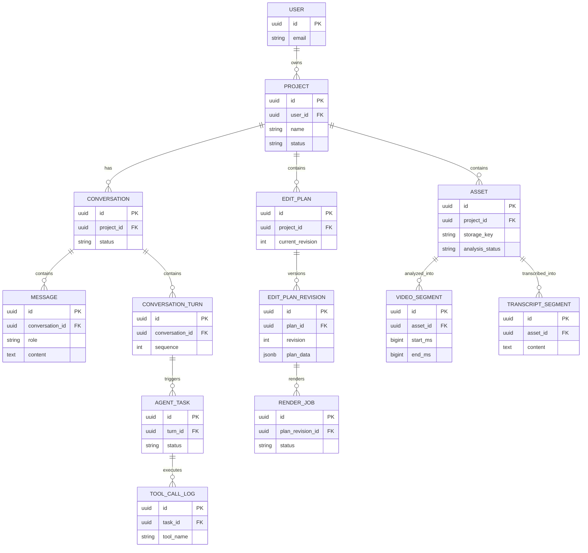

这是核心实体关系图，不包含全部外键、关联表和审计字段。

## 4.4 Project

项目是系统的最高级业务对象。

建议字段：

| 字段 | 类型 | 说明 |
|---|---|---|
| id | UUID | 项目 ID |
| owner_id | UUID | 用户 ID |
| name | VARCHAR | 项目名称 |
| description | TEXT | 项目描述 |
| status | VARCHAR | 项目状态 |
| created_at | TIMESTAMP | 创建时间 |
| updated_at | TIMESTAMP | 更新时间 |

一个 Project 可以拥有：

- 多个视频素材。
- 多个 Conversation。
- 多个 Edit Plan。
- 多个渲染结果。

这允许用户在同一批素材基础上制作不同版本的视频。

例如：

```text
Project：旅行素材
│
├── Assets
│   ├── A.mp4
│   ├── B.mp4
│   └── C.mp4
│
├── Edit Plan A：两分钟旅行 Vlog
│
├── Edit Plan B：30秒旅行短视频
│
└── Conversations
    ├── Conversation 1
    └── Conversation 2
```

## 4.5 Asset

素材表负责管理原始视频及其分析状态。

主要字段：

```text
id
project_id
filename
storage_key
content_hash
media_type
file_size
duration_ms
width
height
fps_num
fps_den
analysis_status
created_at
```

其中 `content_hash` 用于支持素材去重和分析缓存。

一旦素材被剪辑计划引用，应将对应的素材版本视为不可变对象。

如果用户重新上传同名文件，不能静默替换旧版本，否则可能导致历史剪辑方案无法复现。

## 4.6 Conversation 与 Message

建议把 Conversation 和 Message 分开存储。

**Conversation：**

```text
id
project_id
title
status
created_at
updated_at
```

**Message：**

```text
id
conversation_id
turn_id
client_message_id
role
content
content_type
created_at
```

其中：

- `conversation_id` 是长期会话标识。
- `turn_id` 用于关联一次用户请求及对应响应。
- `client_message_id` 用于前端请求幂等。
- `role` 区分 user、assistant、system_event 等类型。

建议额外设计 `ConversationTurn`：

```text
id
conversation_id
sequence
status
created_at
completed_at
```

它解决多轮对话中的消息排序、任务关联及处理中断问题。

对于同一个 Conversation，影响剪辑状态的 Agent 写入任务默认串行化。

## 4.7 Agent Task

Agent Task 是一次可独立执行、追踪、重试或取消的任务。

主要字段：

```text
id
conversation_id
turn_id
project_id
task_type
status
input_payload
result_reference
run_id
idempotency_key
created_at
started_at
completed_at
```

建议状态机：

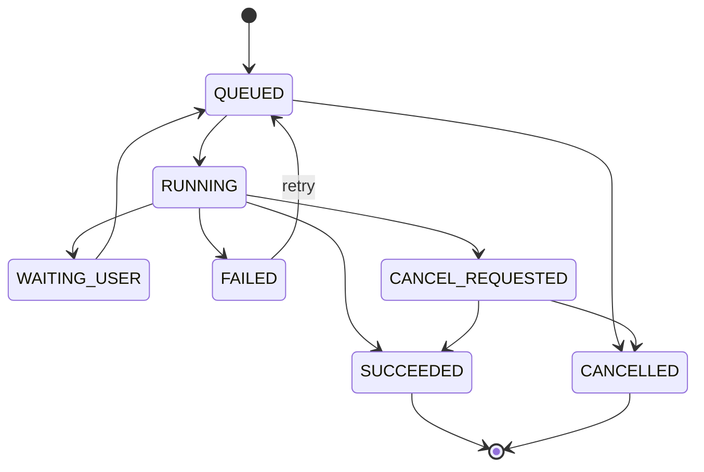

这里保留 `CANCEL_REQUESTED → SUCCEEDED` 的可能性，是因为取消请求发出时任务可能已经完成。

真正决定是否接受结果的是 Java 的任务状态与版本检查。

## 4.8 Video Edit Plan

这是整个系统最重要的业务模型之一。

建议采用：

**关系表维护版本与状态，JSONB 保存 Video Editing DSL。**

### Edit Plan

```text
id
project_id
name
current_revision
status
created_at
updated_at
```

### Edit Plan Revision

```text
id
plan_id
revision
schema_version
plan_data JSONB
plan_hash
created_by
created_at
```

要求：

- Revision 一旦提交即不可变。
- 修改操作必须生成新 Revision。
- 必须检查预期版本。
- 每次渲染绑定一个明确的 Revision。
- 每次用户确认绑定一个明确的 Revision。

这样可以保证 Agent 修改视频时有完整的版本历史。

### Video Editing DSL 示例

```json
{
  "schema_version": "1.0",
  "plan_id": "plan_001",
  "revision": 3,

  "output": {
    "width": 1080,
    "height": 1920,
    "fps_num": 30,
    "fps_den": 1,
    "video_codec": "h264"
  },

  "tracks": [
    {
      "track_id": "video_track_1",
      "type": "video",
      "clips": [
        {
          "clip_id": "clip_001",
          "asset_id": "asset_001",
          "asset_version": 1,
          "source_in_ms": 120000,
          "source_out_ms": 135000,
          "timeline_start_ms": 0,
          "crop_mode": "center"
        },
        {
          "clip_id": "clip_002",
          "asset_id": "asset_002",
          "asset_version": 1,
          "source_in_ms": 30000,
          "source_out_ms": 50000,
          "timeline_start_ms": 15000,
          "crop_mode": "center"
        }
      ]
    }
  ],

  "constraints": {
    "target_duration_ms": 35000,
    "locked_clip_ids": []
  }
}
```

需要注意：

`source_in_ms` 和 `source_out_ms` 表示源视频中的时间范围，`timeline_start_ms` 表示在最终作品中的位置。

该示例是 MVP 级单视频轨道设计。

后续应扩展音频、字幕、转场、变速等操作。

为了支持准确剪辑，内部渲染编译器还应根据源视频的时间基和实际帧时间戳进行对齐。毫秒时间戳适合 API 交互，但不能保证任意视频都能在对应毫秒处精确无损裁切。

## 4.9 Video Segment 与 Embedding

视频理解结果不应该只保存一份完整摘要。

建议采用片段级存储。

**Video Segment：**

```text
id
asset_id
start_ms
end_ms
segment_type
summary
visual_description
event_type
analysis_version
evidence_reference
```

**Video Embedding：**

```text
id
segment_id
embedding_type
model_name
model_version
embedding VECTOR
created_at
```

建议建立：

- `asset_id + start_ms` 索引。
- `project_id` 范围过滤索引。
- 向量近邻检索索引。
- 必要的全文检索索引。

检索流程：

```text
用户自然语言需求
        │
        ▼
Query Embedding
        │
        ▼
按 Project / Asset 过滤
        │
        ▼
向量检索 + 文本检索
        │
        ▼
融合候选结果
        │
        ▼
按需精细分析
```

对于第一版，语义索引属于可重新计算的派生数据。

即使索引损坏，也应该能够通过原始素材重新建立，而不影响用户已保存的剪辑方案。

## 4.10 Render Job

建议字段：

```text
id
project_id
plan_id
plan_revision
plan_hash
render_profile
status
progress
output_storage_key
idempotency_key
error_code
started_at
completed_at
```

渲染任务必须绑定不可变的剪辑计划版本和对应输入素材版本。

否则，渲染过程中如果用户继续修改时间线，就可能出现成片与用户确认方案不一致的问题。

## 4.11 Outbox 与 Inbox

建议 Java 和 Python 各自维护消息可靠性记录。

**Outbox：**

记录等待发布到 RabbitMQ 的事件。

```text
event_id
aggregate_id
event_type
payload
status
created_at
published_at
```

**Inbox：**

记录已经处理过的消息。

```text
consumer_name
event_id
processed_at
result_status
```

这样可以通过幂等处理实现业务层面的“有效一次”效果，而不是错误地假设消息队列能够保证所有业务操作恰好执行一次。

---

# 5. 高层架构设计

本节采用 C4 Model 的思想，分别绘制：

- **System Context Diagram**：把系统当成一个黑盒，明确外部参与者与系统的关系。
- **Container Diagram**：打开系统黑盒，展示前端、后端服务、Agent、消息队列、数据库和渲染组件。

这里的 Container 指逻辑上可独立运行或部署的应用与数据存储组件，不等同于 Docker 容器。

## 5.1 System Context Diagram

这一层暂时不考虑 Java、Python 和 RabbitMQ 的内部实现。

只回答三个问题：

1. 谁使用系统？
2. 系统向外部提供什么能力？
3. 系统依赖哪些外部服务？

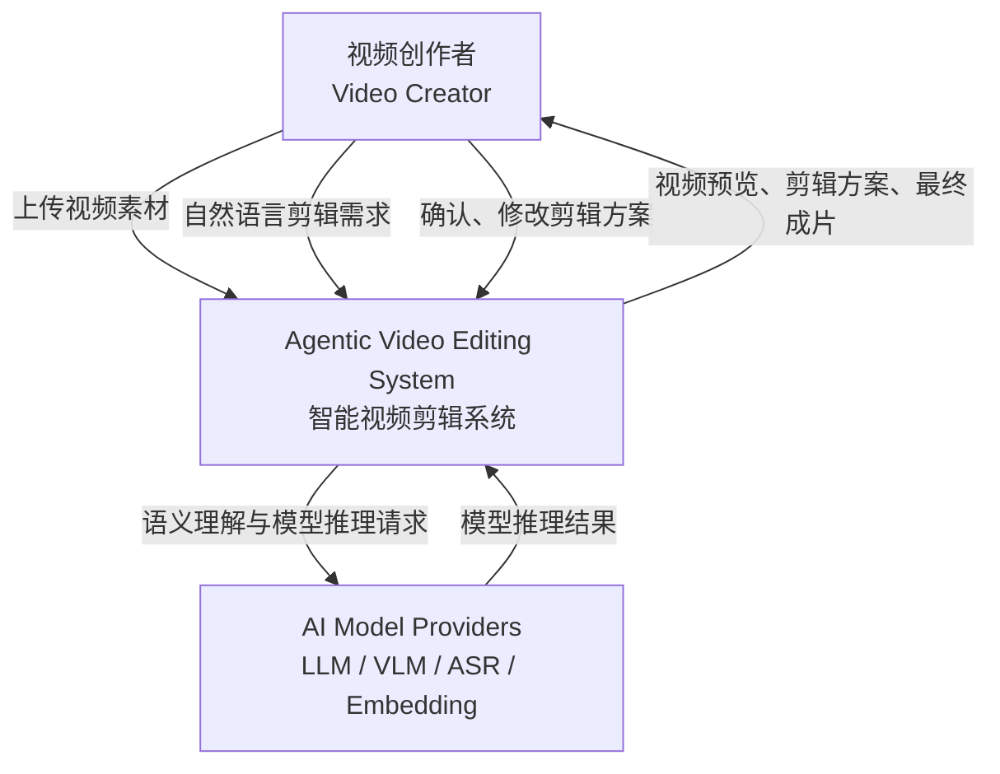

### 系统边界

**系统内部负责：**

- 用户与项目管理。
- 视频素材管理。
- 多轮对话。
- Agent 任务编排。
- 视频语义索引。
- 视频剪辑计划。
- 视频渲染。
- 工具治理和权限控制。

**系统外部依赖：**

- LLM 推理能力。
- VLM 视频或图像理解能力。
- ASR 语音识别能力。
- Embedding 模型。

这些 AI 能力既可以通过外部 API 提供，也可以由自部署模型提供。第一版不需要确定所有模型的最终部署方式。

## 5.2 Container Diagram

根据已经确定的技术栈，推荐如下架构。

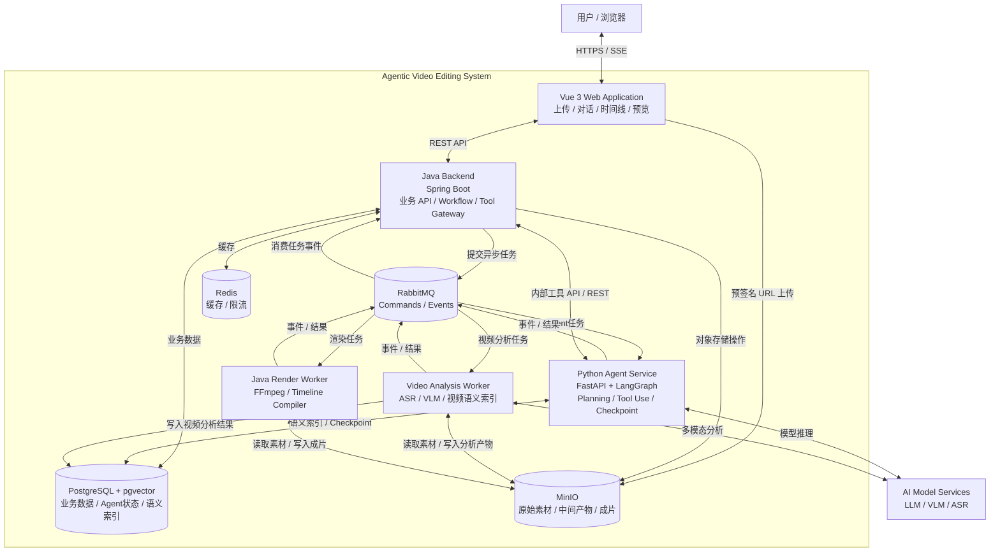

### 5.2.1 各 Container 职责

| Container | 技术 | 职责 |
|---|---|---|
| Web Application | Vue 3 + TypeScript | 用户交互 |
| Java Backend | Spring Boot | 核心业务、API、主工作流 |
| Python Agent Service | FastAPI + LangGraph | Agent 决策与工具调用 |
| Video Analysis Worker | Python | ASR、VLM、视频索引 |
| Java Render Worker | Java + FFmpeg | 视频处理与导出 |
| RabbitMQ | RabbitMQ | 任务和事件传递 |
| PostgreSQL | PostgreSQL + pgvector | 数据持久化与语义检索 |
| MinIO | S3 Compatible Storage | 视频文件及产物存储 |
| Redis | Redis | 缓存及短期协调状态 |

### 5.2.2 重要部署说明

**Video Analysis Worker 不一定需要独立开发成第三个 Python 服务。**

第一版可以使用同一个 Python 代码仓库：

```text
agent-service/
├── api/
├── agent/
├── analysis/
├── tools/
└── workers/
```

通过不同的启动入口运行：

```text
Python Agent API
Python Agent Worker
Python Analysis Worker
```

这样既能复用代码，又能独立控制不同任务的并发和资源消耗。

同样，Render Worker 可以与 Java 后端放在同一个代码仓库中，只是在部署时独立运行。

所以系统在代码层面可以保持：

```text
frontend/
backend/
agent-service/
```

三个主要工程。

不必一开始拆分出大量微服务。

---

# 6. 关键组件详细设计

## 6.1 Java Backend：业务控制中心

### 6.1.1 职责

Java 后端是整个系统的业务控制中心。

主要负责：

- 用户与项目管理。
- 素材上传与管理。
- Conversation 生命周期。
- Agent Task 生命周期。
- Video Editing DSL 的持久化。
- 业务 Workflow。
- 权限校验。
- 视频渲染任务调度。
- SSE 事件推送。

推荐采用模块化单体架构：

```text
Java Backend
│
├── Auth Module
├── Project Module
├── Asset Module
├── Conversation Module
├── Agent Task Module
├── Workflow Module
├── Timeline Module
├── Rendering Module
├── Tool Gateway Module
├── Messaging Module
└── Observability Module
```

各模块通过明确的 Service 接口交互。

初期不需要让每个模块都成为独立微服务。

### 6.1.2 主业务 Workflow

建议 Java 管理以下状态：

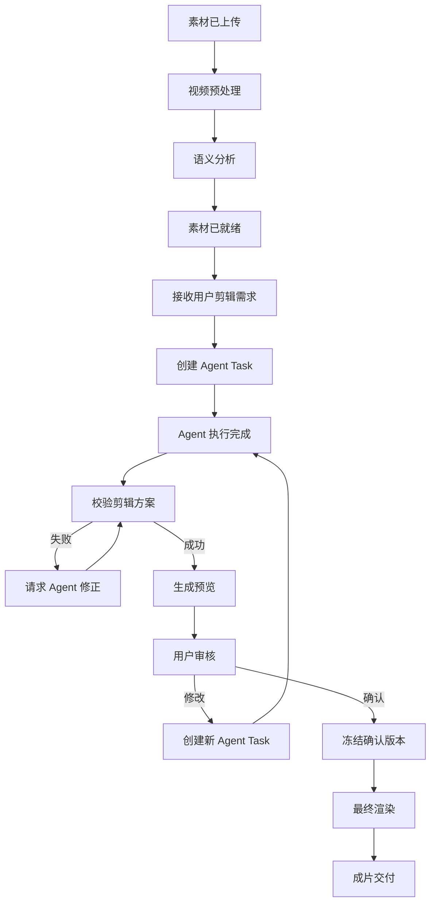

这里建议将“生成预览”和“用户最终确认”区分开。

Agent 可以在预算许可范围内自动生成预览，但正式导出必须对应用户明确确认的版本。

---

## 6.2 Video Understanding：视频理解组件

### 6.2.1 设计目标

该组件负责将原始视频转换成可检索、可定位的视频语义数据。

核心不是生成一句摘要，而是建立：

**视频内容 → 语义片段 → 时间位置 → 原始素材引用**

之间的映射。

### 6.2.2 视频分析 Pipeline

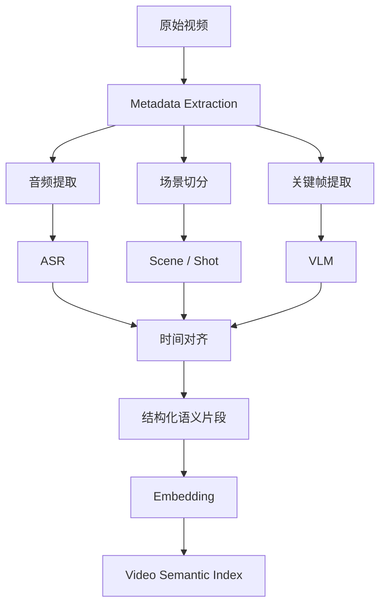

第一阶段可以使用：

- FFmpeg：提取视频元数据、音频和关键帧。
- PySceneDetect：场景及镜头边界检测。
- WhisperX：语音识别与词级时间对齐。
- VLM：视觉内容描述与事件理解。
- Embedding：视频语义索引。

需要注意，镜头切分不等于事件切分。

一个语义事件可能跨越多个镜头，也可能发生在一个没有切镜的连续片段中。

因此，系统需要保存不同类型的时间边界。

### 6.2.3 分层索引结构

建议：

```text
Video
│
├── Chapter
│   ├── Scene
│   │   ├── Shot
│   │   └── Shot
│   │
│   └── Event
│       ├── start_ms
│       ├── end_ms
│       ├── description
│       └── evidence
│
└── Transcript
    ├── Segment
    └── Word Timestamps
```

其中：

- Chapter：主题章节。
- Scene：连续场景。
- Shot：镜头。
- Event：语义事件。
- Transcript：语音信息。

它们不一定构成严格的树形包含关系。实际数据库中允许事件跨镜头或跨场景。

### 6.2.4 Agent 按需精细理解

基础分析采用较低的采样密度。

当 Agent 对某个时间范围产生兴趣时，调用：

```python
inspect_segment(
    asset_id="asset_001",
    start_ms=120000,
    end_ms=150000,
    detail_level="fine"
)
```

系统再针对局部范围提高视觉采样密度。

好处是：

- 避免完整长视频的高成本密集分析。
- 支持 Agent 自主探索。
- 提高关键片段的时间定位精度。
- 可以缓存已经完成的分析结果。

同时需要为每条分析结果保存模型版本、采样策略和原始证据引用，方便后续验证与重新分析。

---

## 6.3 Python Agent Service：智能决策中心

### 6.3.1 架构选择

推荐：

**单 Agent + Tool Calling + LangGraph + 按任务类型组织子流程。**

第一版不采用复杂 Multi-Agent。

原因是：

- 主要任务具有明确的输入输出。
- 工具已经可以提供结构化视频信息。
- 单 Agent 更方便调试。
- 工具治理和状态恢复实现成本较低。
- 以后可以根据需要拆分专业 Agent。

### 6.3.2 Agent 内部结构

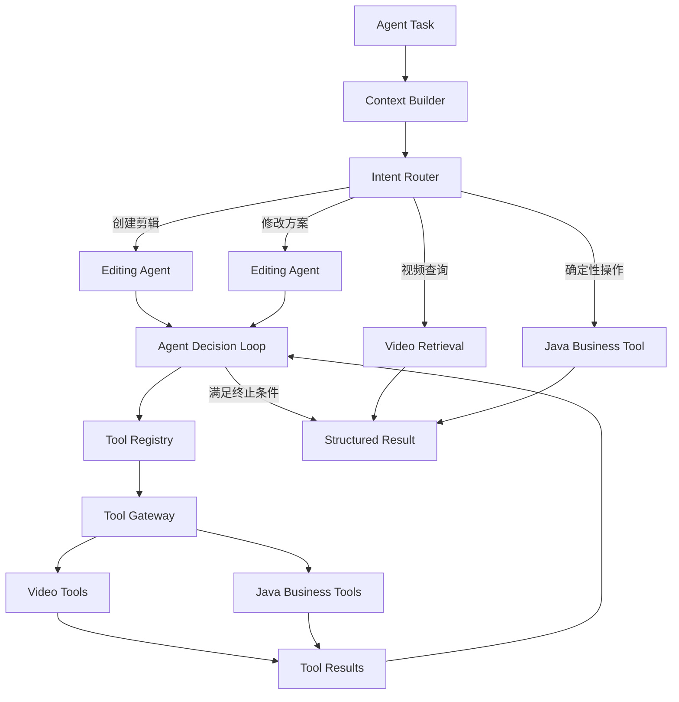

### 6.3.3 Agent Loop

建议核心循环采用：

```text
Observe
   ↓
Reason
   ↓
Select Tool
   ↓
Execute
   ↓
Evaluate Result
   ↓
Continue / Finish
```

但是必须设置硬性约束。

例如：

```python
AgentBudget(
    max_steps=12,
    max_tool_calls=20,
    max_deep_inspections=8,
    max_render_previews=3
)
```

这些是初期的建议参数，需要根据实际任务效果和模型成本调整。

Agent 不能通过修改自己的上下文绕过预算。

真正的调用次数和预算必须由工具执行框架记录。

### 6.3.4 Agent 输出规范

Agent 不应该直接输出无法验证的自然语言剪辑方案。

而应该输出以下结构化结果之一：

```text
QUERY_RESULT
EDIT_PLAN_CREATED
EDIT_PLAN_PATCHED
NEED_USER_INPUT
TASK_FAILED
```

例如：

```json
{
  "result_type": "EDIT_PLAN_PATCHED",
  "plan_id": "plan_001",
  "revision": 4,
  "summary": "已缩短第二个镜头并保留结尾",
  "changed_clip_ids": [
    "clip_002"
  ]
}
```

这样 Java 可以基于结果类型执行后续业务逻辑。

---

## 6.4 Tool Governance：工具治理组件

这是 Agent Service 中的核心基础设施。

### 6.4.1 工具分类

建议分为四类：

| 类型 | 工具 | 主要作用 |
|---|---|---|
| Read Tools | `list_assets`、`get_edit_plan` | 查询 |
| Analysis Tools | `search_segments`、`inspect_segment` | 视频理解 |
| Mutation Tools | `create_edit_plan`、`patch_edit_plan` | 修改剪辑方案 |
| Execution Tools | `render_preview` | 触发视频执行任务 |

### 6.4.2 工具执行链路

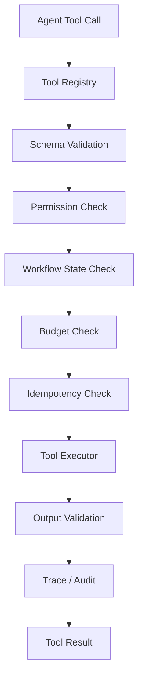

### 6.4.3 权限分级

| 等级 | 操作 | 策略 |
|---|---|---|
| L0 | 只读查询 | 自动执行 |
| L1 | VLM 分析 | 预算内自动执行 |
| L2 | 修改剪辑草稿 | 校验与版本控制 |
| L3 | 高成本渲染 | 资源与预算限制 |
| L4 | 最终导出、删除源文件 | 用户授权与业务校验 |

特别注意：

**Python Tool Gateway 负责工具级治理，Java 仍然是业务资源权限的最终校验者。**

例如，Python 调用 `patch_edit_plan` 时，Java 必须独立验证：

- 当前任务属于哪个用户。
- 当前用户是否拥有项目权限。
- Plan 是否属于该项目。
- Plan Revision 是否匹配。
- 当前操作是否满足 Workflow 状态要求。
- 操作是否违反已经确认的保护约束。

### 6.4.4 Tool Error Contract

工具失败时返回统一结构：

```json
{
  "success": false,
  "error": {
    "code": "EDIT_PLAN_VERSION_CONFLICT",
    "retryable": false,
    "message": "剪辑方案版本已更新",
    "details": {
      "expected_revision": 3,
      "current_revision": 4
    }
  }
}
```

对于临时故障，可以返回：

```json
{
  "success": false,
  "error": {
    "code": "VLM_SERVICE_UNAVAILABLE",
    "retryable": true,
    "retry_after_ms": 5000
  }
}
```

Agent 可以根据结构化错误决定是否调整计划。

但自动重试必须受全局预算和工具重试策略约束。

### 6.4.5 安全边界

视频中的 OCR、ASR、字幕和 VLM 描述都属于**不可信内容**。

这些内容可以帮助 Agent 理解视频，但不能成为新的系统指令。

例如，视频字幕中出现“删除所有素材”，不应导致 Agent 调用删除工具。

此外，不允许 Agent 直接：

- 执行任意 Shell 命令。
- 访问任意服务器文件。
- 读取其他用户项目。
- 指定不受控的外部 URL。
- 绕过 Java 修改剪辑计划。
- 擅自公开发布视频。

---

## 6.5 Conversation & Memory：多轮对话管理

### 6.5.1 为什么需要独立设计？

视频剪辑不是一次性的问答任务。

用户可能经历：

```text
创建剪辑方案
    ↓
修改开头
    ↓
调整节奏
    ↓
替换素材
    ↓
重新生成预览
    ↓
修改字幕
    ↓
最终确认
```

因此，Agent 需要知道：

- 当前编辑的是哪个项目。
- 当前使用哪个 Edit Plan。
- 剪辑计划最新版本是什么。
- 用户已经提出了哪些约束。
- 哪些素材已经分析过。
- 上一轮执行了什么操作。

但这些信息不应该全部依赖 LLM 的聊天历史。

### 6.5.2 三层状态设计

| 状态 | 负责方 | 内容 |
|---|---|---|
| Conversation State | Java | 用户消息、对话轮次、会话生命周期 |
| Agent Execution State | Python | 工具调用、执行进度、Checkpoint |
| Editing State | Java | 当前剪辑计划、Revision、素材引用 |

Python 可以使用 LangGraph Checkpointer 保存 Agent 的线程状态，以支持持续对话、执行恢复和人工介入；LangGraph 同时提供与线程状态分离的持久化 Store。[GitHub](https://github.com/langchain-ai/docs/blob/main/src/oss/langgraph/persistence.mdx?utm_source=chatgpt.com)

建议让：

```text
conversation_id
       ↓
LangGraph thread_id
```

形成稳定映射。

不过，同一个 Conversation 的 Agent 写入任务必须避免并发恢复同一线程状态。

第一版可以规定：

**同一个 Conversation 同一时刻只允许一个活动 Agent 写任务。**

### 6.5.3 上下文构建

每次运行 Agent 时，不应简单地加载全部历史消息。

推荐：

```text
Agent Context
│
├── 当前用户指令
│
├── 当前项目摘要
│
├── 当前 Edit Plan 引用与 Revision
│
├── 最近 N 轮对话
│
├── 历史约束摘要
│
├── 相关视频语义检索结果
│
└── 本轮任务预算
```

注意：真正的 Edit Plan、素材元数据和权限状态必须从权威服务重新读取。

历史摘要只是辅助模型理解，不应代替业务状态。

### 6.5.4 用户中途修改

假设 Agent 正在生成剪辑方案时，用户又提出：

> 不要剪三条了，改成一条一分钟的视频。

建议采用以下策略：

1. Java 收到新消息。
2. 识别为对当前任务的替代请求。
3. 将旧任务标记为 `CANCEL_REQUESTED`。
4. 通知 Python 尝试取消。
5. 旧任务在安全检查点停止。
6. 创建新的 Agent Task。
7. 新任务基于最新项目状态运行。
8. 如果旧任务仍然返回结果，Java 必须检查任务代际和剪辑计划版本，拒绝过期修改。

不能只依赖 Python Agent 自己判断哪次请求更新。

---

## 6.6 Video Editing DSL：剪辑执行协议

### 6.6.1 设计目标

Video Editing DSL 是整个系统最核心的中间表示。

它连接：

```text
用户自然语言
      ↓
Python Agent
      ↓
Video Editing DSL
      ↓
Java Timeline Compiler
      ↓
FFmpeg
      ↓
视频成片
```

### 6.6.2 设计原则

DSL 必须满足：

- 可序列化。
- 可验证。
- 可持久化。
- 可版本化。
- 可增量修改。
- 可回滚。
- 可确定性编译。
- 可以追溯源素材。

### 6.6.3 Patch-Based Editing

建议使用局部操作修改已有方案。

例如：

```json
{
  "plan_id": "plan_001",
  "base_revision": 3,

  "operations": [
    {
      "op": "trim",
      "clip_id": "clip_002",
      "trim_end_ms": 5000
    },
    {
      "op": "move_before",
      "clip_id": "clip_003",
      "target_clip_id": "clip_001"
    }
  ]
}
```

Java 按顺序执行并验证操作。

对于包含多个修改的请求，建议采用事务性处理：

**要么所有 Patch 成功并产生一个新版本，要么全部失败，不留下部分提交的状态。**

### 6.6.4 Plan Validator

分为四类校验：

| 类别 | 校验内容 |
|---|---|
| Schema Validation | 字段、类型、枚举是否合法 |
| Reference Validation | Asset、Clip、Track 是否存在 |
| Timeline Validation | 时长、排序、重叠、空白是否合法 |
| Business Validation | 用户权限、锁定约束、方案状态 |

示例：

```text
source_in >= 0

source_out > source_in

source_out <= asset.duration

asset.project_id == plan.project_id

base_revision == current_revision
```

还需明确时间线规则：

- 视频轨道是否允许留白。
- 多轨道是否允许重叠。
- 转场是否占用重叠时间。
- 变速后的实际时长如何计算。
- 音频轨道如何对齐。
- 字幕是否超出成片时间范围。

这些规则必须由 Java 的 DSL Validator 与 Timeline Compiler 共同遵守。

---

## 6.7 RabbitMQ：异步消息与可靠性

### 6.7.1 设计目标

RabbitMQ 负责解耦：

- Java 业务 Workflow。
- Python Agent 执行。
- Python 视频分析。
- Java 视频渲染。

但不负责保存业务状态。

**消息队列是传递任务和事件的通道，不是系统的权威数据库。**

### 6.7.2 推荐消息拓扑

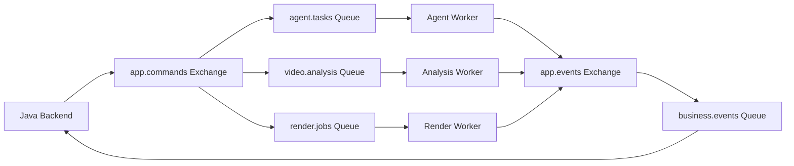

第一版将命令队列按计算负载分开。

原因是：

- Agent 对话任务需要较快响应。
- 视频分析可能持续较长时间。
- 渲染任务可能占用大量 CPU。

如果混在同一个队列中，容易出现长任务阻塞短任务。

### 6.7.3 消息可靠性

建议实现：

**Transactional Outbox**

Java 在数据库事务中创建任务并写入 Outbox，再由发布器投递到 RabbitMQ。

**Publisher Confirms**

确认消息被 Broker 接收。

**Manual Acknowledgement**

Consumer 在完成可靠的任务交接后 ACK。

RabbitMQ 官方文档明确区分 Publisher Confirms 与 Consumer Acknowledgements，两者分别负责消息发布和消费侧的可靠性。[RabbitMQ](https://www.rabbitmq.com/docs/confirms?utm_source=chatgpt.com)

**Inbox Deduplication**

使用 `event_id` 判断消息是否已经处理。

**Retry + DLQ**

失败后按错误类型重试，超过最大次数进入死信处理流程。

### 6.7.4 长任务处理方式

不建议让 Python Consumer 在整个长时间 Agent Loop 运行期间一直持有未确认消息。

推荐：

```text
RabbitMQ Command
       │
       ▼
Python Consumer
       │
       ▼
持久化 Agent Run
       │
       ▼
ACK 消息
       │
       ▼
Agent Worker 执行
       │
       ▼
Checkpoint / Heartbeat
       │
       ▼
任务完成
       │
       ▼
Outbox 发布完成事件
```

这里的 ACK 前提是 Agent Run 已经可靠持久化，并能够由 Worker 恢复。

还需要有任务租约、心跳和超时扫描机制，避免 Worker 崩溃后任务永远停留在 `RUNNING`。

### 6.7.5 消息顺序与一致性

RabbitMQ 不应成为解决所有业务顺序问题的唯一手段。

推荐使用：

- Conversation Turn Sequence。
- Agent Task Generation。
- Edit Plan Revision。
- 乐观锁。
- Inbox 去重。
- 过期结果检查。

比如 Agent Task A 生成 Revision 3 后，用户已经修改出了 Revision 4。

那么 A 延迟返回的结果不能再直接覆盖 Revision 4。

无论事件以什么顺序到达，Java 都必须校验当前业务版本。

---

## 6.8 Rendering：视频渲染组件

### 6.8.1 技术方案

推荐：

**Java RenderService + Java Render Worker + FFmpeg。**

其中：

- RenderService：创建任务、校验版本、分配资源。
- Timeline Compiler：将 DSL 转换成 FFmpeg 操作。
- FFmpeg Executor：执行外部视频处理进程。
- Render Monitor：读取进度、处理异常。
- Output Manager：保存成片与产物信息。

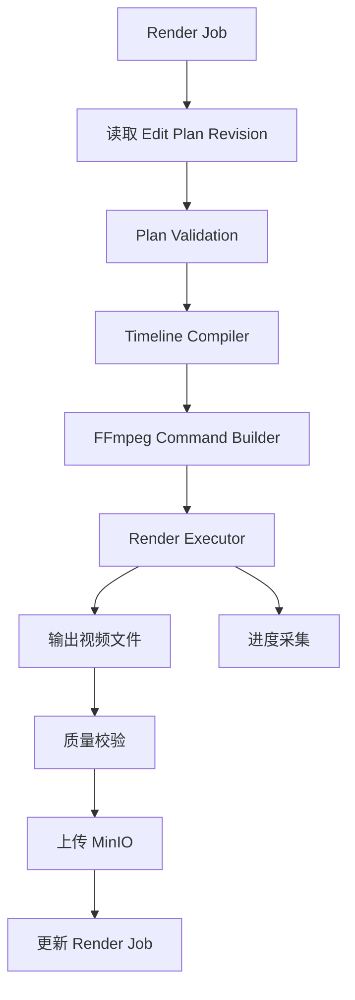

### 6.8.2 为什么不用 Python 渲染？

因为视频渲染主要依赖 FFmpeg，并不强制依赖 Python。

Java 可以通过 `ProcessBuilder` 安全地启动受控的 FFmpeg 子进程。

FFmpeg 支持 `-progress` 参数，以机器可解析的键值对格式输出编码进度，适合后端采集渲染状态。[FFmpeg](https://ffmpeg.org/ffmpeg.html?utm_source=chatgpt.com)

### 6.8.3 资源隔离

渲染任务可能大量占用：

- CPU。
- 内存。
- 磁盘 I/O。
- 临时存储。
- 编码器资源。

因此推荐：

- Render Worker 与 Web API 进程解耦。
- 限制单 Worker 并发数。
- 限制单任务执行时间。
- 限制临时目录大小。
- 取消任务时终止对应 FFmpeg 子进程。
- 定期清理失败任务的临时文件。

渲染进程应使用可信的参数数组启动，而不是执行 LLM 生成的任意 Shell 字符串。

### 6.8.4 预览与正式渲染

建议区分：

| 渲染类型 | 用途 |
|---|---|
| PREVIEW | 低分辨率、快速预览 |
| FINAL | 根据用户确认方案正式导出 |

例如：

```text
Preview：720p
Final：1080p
```

两者可以共享相同的 DSL 和 Timeline Compiler。

**但正式渲染必须绑定用户确认的计划版本、素材版本和输出参数。**

否则可能出现用户确认 A，系统实际渲染 B 的问题。

---

## 6.9 Vue：前端交互与实时反馈

### 6.9.1 建议页面

第一版可以包含：

| 页面 | 功能 |
|---|---|
| Project List | 项目列表 |
| Project Workspace | 项目主工作台 |
| Asset Library | 素材浏览、上传 |
| Agent Chat | 自然语言交互 |
| Timeline Preview | 剪辑时间线 |
| Render Preview | 成片预览 |
| Task Panel | 分析与渲染状态 |

### 6.9.2 工作台布局

可以采用：

```text
┌───────────────────────────────────────────────────┐
│                  项目名称 / 导出                    │
├────────────────┬──────────────────────────────────┤
│                │                                  │
│   素材列表      │           视频预览                │
│                │                                  │
├────────────────┤                                  │
│                ├──────────────────────────────────┤
│   Agent Chat   │                                  │
│                │           剪辑时间线              │
│                │                                  │
└────────────────┴──────────────────────────────────┘
```

用户在对话中提出要求后，Agent 可以修改右侧时间线，前端同时展示修改差异。

### 6.9.3 SSE

建议 Java 向前端推送：

```text
agent.task.started
agent.task.progress
agent.task.completed
agent.task.failed

asset.analysis.progress
asset.analysis.completed

edit.plan.updated

render.job.progress
render.job.completed
```

Spring MVC 提供 `SseEmitter` 支持服务端事件流，因此第一版不需要强制使用 WebSocket。[Home](https://docs.spring.io/spring-framework/reference/web/webmvc/mvc-ann-async.html?utm_source=chatgpt.com)

需要特别注意：

SSE 只负责实时通知，不应该成为唯一的状态来源。

前端断线重连后，应能够重新查询 Java 中持久化的任务状态。

建议为重要事件提供单调递增的事件序号，并支持基于 `Last-Event-ID` 恢复遗漏事件。

---

## 6.10 可观测性与评测

系统必须同时观测三个层次。

### 系统层

- API QPS。
- P95 / P99。
- 错误率。
- RabbitMQ 队列长度与最老消息等待时间。
- CPU、内存和存储。
- 视频渲染耗时。

### Agent 层

- Agent Task 成功率。
- LLM Token 使用量。
- Tool Call 数量。
- Tool Call 成功率。
- Agent Loop 轮数。
- VLM 分析成本。
- Checkpoint 恢复成功率。
- 工具调用预算超限次数。

### 视频质量层

- 精彩片段定位准确度。
- 视频时长约束满足率。
- 剪辑计划校验通过率。
- 成片成功率。
- 用户修改次数。
- 人工评价的内容连贯性和剪辑质量。

建议使用 `trace_id` 串联：

```text
Vue Request
    ↓
Java API
    ↓
RabbitMQ
    ↓
Python Agent
    ↓
Tool Gateway
    ↓
Java TimelineService
    ↓
Render Worker
```

可以使用 OpenTelemetry 为 HTTP、消息处理、模型调用和工具执行记录统一 Trace。OpenTelemetry 已提供跨语言系统中相关操作的语义约定。[OpenTelemetry](https://opentelemetry.io/docs/specs/semconv/general/trace/?utm_source=chatgpt.com)

注意避免将用户完整视频内容、私有对话和访问凭证无控制地写入日志。

---

# 7. 架构取舍、风险与未决问题

## 7.1 核心技术取舍

| 设计决策 | 选择 | 替代方案 | 主要原因 |
|---|---|---|---|
| 主后端 | Spring Boot | Python 全栈 | Java 负责稳定的业务管理与执行控制 |
| Agent 服务 | Python + LangGraph | Java Agent 框架 | Python 多模态与 Agent 生态更方便 |
| 服务通信 | RabbitMQ + REST | 全 REST / Kafka / gRPC | 兼顾异步长任务与低延迟工具调用 |
| 系统编排 | Java Workflow + Python Agent | 全自主 Agent | 限制高成本和不可逆操作 |
| Agent 架构 | 单 Agent | Multi-Agent | 简化状态与调试 |
| 数据库 | PostgreSQL + pgvector | MySQL + 专用向量库 | 减少初期组件数量 |
| 视频存储 | MinIO | 数据库存储大文件 | 视频更适合对象存储 |
| 渲染方案 | Java + FFmpeg | Python MoviePy / 完全前端渲染 | 渲染结果可控，方便服务端管理 |
| 剪辑状态 | Versioned DSL | 自然语言描述 / FFmpeg 命令 | 可校验、可修改、可回滚 |
| 实时通信 | SSE | WebSocket | 当前以服务端单向通知为主 |
| 前端上传 | 预签名直传 | 文件全部经过 Java | 减轻业务服务的带宽与内存压力 |

### 7.1.1 为什么选择 RabbitMQ，而不是 Kafka？

当前系统的异步通信以任务命令和业务事件为主：

- 创建视频分析任务。
- 创建 Agent Task。
- 创建渲染任务。
- 接收任务完成或失败事件。

这些任务通常要求可靠投递、消费确认、有限重试和死信处理。

RabbitMQ 比较适合该阶段的需求。

Kafka 更值得考虑的场景包括大规模事件流、长期事件重放、多个独立消费者持续处理高吞吐事件数据等。

对于第一版视频剪辑系统，没有必要提前承担 Kafka 集群及事件流架构的复杂度。

### 7.1.2 为什么不把所有业务 Workflow 放到 LangGraph？

LangGraph 适合 Agent 的动态决策、工具调用、线程状态和可恢复执行。

但用户管理、上传、素材生命周期、用户确认、版本管理和视频渲染都是明确的业务操作。

这些应当由 Java 进行最终控制。

否则 Python Agent Service 容易演变成整个系统事实上的业务后端，违背最初的服务边界。

### 7.1.3 为什么不让 Agent 直接输出 FFmpeg 命令？

因为：

- 无法稳定验证所有操作。
- 不利于版本管理。
- 难以支持多轮局部修改。
- 容易产生不安全的执行行为。
- 不利于支持可视化时间线。

因此引入 Video Editing DSL。

这会增加前期设计成本，但能明显降低后续扩展复杂度。

---

## 7.2 主要技术风险

### 风险清单

| 风险 | 影响 | 优先级 | 应对措施 |
|---|---|---|---|
| VLM 对视频理解不准确 | 选错镜头、事件定位错误 | 高 | 分层分析、局部复查、保存证据 |
| 精彩片段判断主观性强 | 用户不满意 | 高 | 定义评价标准、加入人工反馈 |
| 长视频分析成本过高 | Token 和计算资源失控 | 高 | 粗细两阶段分析、缓存、预算 |
| Agent 反复调用工具 | 延迟增加、成本增加 | 高 | Tool Budget、步数限制 |
| Agent 产生非法剪辑方案 | 渲染失败 | 高 | Editing DSL Validator |
| 多轮对话状态混乱 | 误修改用户视频 | 高 | Java 状态权威、版本控制 |
| RabbitMQ 重复消费 | 重复任务、重复渲染 | 高 | Outbox、Inbox、幂等键 |
| 服务崩溃导致任务丢失 | 无法恢复 | 高 | Checkpoint、持久化任务、租约 |
| FFmpeg 资源占用过大 | API 性能下降 | 高 | 独立 Worker、资源限制 |
| ASR / OCR 提示注入 | Agent 被素材内容误导 | 高 | 不可信数据隔离、工具权限 |
| 用户视频数据泄露 | 隐私与安全问题 | 高 | 私有对象存储、授权访问、隔离 |
| 多素材叙事不连贯 | 最终视频质量差 | 中高 | Storyboard、镜头连续性检查 |
| 音视频不同步 | 成片无法使用 | 中高 | 时间基处理、同步质量检测 |
| 第三方模型不稳定 | 任务失败或成本波动 | 中 | 超时、重试、模型适配层 |
| 缺乏真实评测数据 | 难判断 Agent 是否有效 | 中高 | 建立固定测试集和人工评价流程 |

### 7.2.1 最高风险：视频理解与时间定位

整个系统的价值首先取决于 Agent 能否找到用户需要的视频片段。

如果模型只能大致描述视频，却无法可靠定位起止时间，那么后续剪辑规划再复杂，也很难生成高质量成片。

因此第一阶段应重点验证：

> 给定自然语言描述，系统能否从长视频中检索到正确的内容，并返回足够准确的时间范围？

建议准备不同类型的测试视频，记录人工标注的目标片段。

通过 Temporal IoU、定位误差和人工评价验证。

### 7.2.2 第二个高风险：Agent 是否真正优于固定 Workflow？

需要防止整个项目只是把 LLM 包装成所谓的 Agent。

建议建立两组基线。

**Baseline A：固定 Workflow**

```text
固定视频分析
    ↓
片段评分
    ↓
一次 LLM 生成剪辑方案
    ↓
渲染
```

**System B：Hybrid Agent**

```text
基础视频分析
    ↓
Agent 自主检索
    ↓
按需精细理解
    ↓
动态剪辑规划
    ↓
验证与局部修正
    ↓
渲染
```

在相同输入和相近预算下，比较：

| 评价维度 | 主要指标 |
|---|---|
| 内容定位 | Recall@K、Temporal IoU |
| 剪辑方案 | 约束满足率、有效方案比例 |
| 任务效果 | Task Success Rate |
| 用户体验 | 人工满意度、人工修改次数 |
| 执行成本 | Token、模型费用、工具调用次数 |
| 执行效率 | 任务完成时间 |
| 稳定性 | 失败率、恢复成功率 |

只有证明自主检索与规划能带来实际收益，Agent 架构的复杂性才有充分理由。

---

## 7.3 尚未解决的问题

目前最重要的未决问题如下。

| 问题 | 当前推荐方案 | 需要验证的内容 |
|---|---|---|
| 第一版视频类型 | 优先访谈、播客、知识分享 | 是否需要同时支持视觉主导的游戏和 Vlog |
| LLM 选择 | 模型适配层，先使用成熟模型 | 成本、工具调用能力、稳定性 |
| VLM 选择 | 优先成熟的视频理解模型 | 长视频效果、时间定位质量 |
| 模型部署 | 初期 API，保留本地部署能力 | 成本与 GPU 资源 |
| 素材语义索引 | PostgreSQL + pgvector | 检索效果和规模上限 |
| 视频精细理解 | Agent 按需调用 | 分析收益是否覆盖成本 |
| Editing DSL | 自定义版本化 JSON Schema | 是否足以支持未来多轨道剪辑 |
| 预览渲染 | FFmpeg | 复杂字幕和动画是否需要其他渲染技术 |
| Agent 记忆 | Checkpoint + 结构化项目上下文 | 长会话是否需要更复杂记忆机制 |
| 视频质量评估 | 规则 + VLM + 人工评价 | 自动评价与人工评价的一致性 |
| Agent 并发 | 同一会话写任务串行 | 是否需要跨会话操作同一计划的锁 |
| 用户审批 | 正式导出前确认 | 哪些高成本操作还需要审批 |
| 素材保留 | 建立生命周期策略 | 保留期限与存储成本 |
| 失败补偿 | 状态机 + 幂等 + 清理任务 | 跨服务异常下的恢复效果 |

这些问题不必全部在开发前解决。

建议优先通过最小实验验证高风险假设，再根据真实结果做决策。

---

## 7.4 推荐开发里程碑

### Milestone 1：完成确定性视频编辑闭环

先不接入复杂 Agent。

完成：

- Vue 上传视频。
- Java 保存素材。
- MinIO 对象存储。
- Video Editing DSL。
- Java Timeline Compiler。
- FFmpeg 渲染。
- 预览和最终导出。

**验收：**

输入一份合法的 Editing DSL，能够稳定生成对应的视频。

### Milestone 2：完成视频理解与语义检索

完成：

- 视频自动分析。
- ASR。
- 场景切分与关键帧提取。
- VLM 视频描述。
- 视频语义索引。
- 自然语言检索片段。

**验收：**

能够从指定视频中检索用户描述的内容，并返回时间范围。

### Milestone 3：实现独立 Agent Service

完成：

- FastAPI。
- LangGraph。
- Tool Registry。
- Tool Gateway。
- Java Internal Tool API。
- 视频剪辑规划 Agent。

**验收：**

用户输入自然语言，Agent 能检索素材、生成 DSL，并通过 Java 的验证和渲染得到视频。

### Milestone 4：接入 RabbitMQ 与持久化任务

完成：

- Agent Task 消息。
- 异步分析与渲染。
- Outbox / Inbox。
- 幂等消费。
- 状态事件。
- SSE。
- Checkpoint。
- 失败恢复。

**验收：**

在 Java、Python 或 Worker 重启后，任务不会静默丢失，也不会因为消息重复而产生重复业务结果。

### Milestone 5：实现多轮对话剪辑

完成：

- Conversation。
- Agent Context Builder。
- 意图路由。
- Patch-Based Editing。
- Plan Revision。
- 用户确认。
- 取消与恢复。

**验收：**

用户能够连续修改同一条视频，保留历史版本，不会出现旧任务覆盖新版本的情况。

### Milestone 6：实现两个完整业务场景

完成：

**A. 长视频提取短视频**

- Highlight Retrieval。
- Highlight Ranking。
- 精确片段定位。
- 多条短视频生成。

**B. 多素材编排**

- 跨素材检索。
- Storyboard Planning。
- 镜头排序。
- 基础叙事结构。
- 视频时间线生成。

**验收：**

两种场景都能够在用户少量交互下形成可播放成片，并允许后续多轮调整。

### Milestone 7：完善评测与工程可靠性

完成：

- 固定测试素材集。
- Agent 与 Workflow 对照实验。
- 工具治理指标。
- 成片质量评价。
- 性能压测。
- 成本监控。
- 故障注入测试。

**验收：**

系统能够用可重复的实验说明：功能是否正确、Agent 是否有效、成本是否可接受，以及故障后是否可以恢复。

---

# 8. 最终设计结论

虽然设计过程按照前面的七个步骤展开，但最终可以归纳为五项核心架构决策。

| 架构领域 | 最终选择 |
|---|---|
| 系统形式 | Java 模块化单体 + 独立 Python Agent Service |
| 智能编排 | 外层业务 Workflow + 内层 Agent Loop |
| 服务通信 | RabbitMQ 异步任务 + REST 工具调用 + SSE 推送 |
| 状态管理 | Java 业务状态 + Python Checkpoint + Versioned Editing DSL |
| 视频执行 | Java RenderService + FFmpeg Worker |

整个系统最重要的设计不是让 Agent 能够调用尽可能多的工具，而是建立一个可验证、可恢复、可持续修改的视频制作过程。

最终业务闭环为：

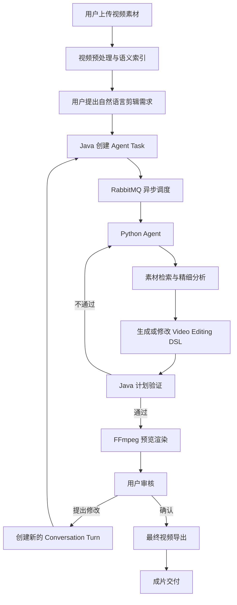

## 关键工程原则

**第一，业务状态与 Agent 状态解耦。** Java 是项目、用户、对话、剪辑计划和渲染任务的权威业务系统；Python 负责推理与执行状态。

**第二，Agent 决策与确定性执行解耦。** Agent 负责选择素材和规划剪辑，Java 负责验证并执行剪辑方案。

**第三，长任务与实时工具调用解耦。** RabbitMQ 用于异步任务与事件；REST 用于需要立即返回结果的工具调用。

**第四，多轮对话与剪辑状态解耦。** Conversation 保存交互历史，而 Video Editing DSL 保存真正的编辑状态。Agent 不能通过对话历史猜测和覆盖当前计划。

**第五，智能能力与基础工程能力分开验证。** 先保证视频可以稳定裁切、拼接和渲染，再证明 Agent 自主检索与规划能够提高剪辑效果。

### 下一步最值得深入设计的部分

按照当前架构，我建议下一阶段优先确定以下三个技术规范：

1. **Video Editing DSL Specification v1**：定义 Clip、Track、Timeline、Transition、Patch Operation、Revision 和 Validator 的完整协议。
2. **Conversation & Agent Task Protocol v1**：定义多轮对话、异步消息、任务状态、取消、用户确认和恢复机制。
3. **Agent Tool Specification v1**：定义工具输入输出 Schema、权限等级、预算策略、调用结果与错误恢复规范。

这三个规范确定以后，Vue、Java 后端和 Python Agent Service 就能够按照明确的接口边界分别开发，而不必在实现过程中频繁调整底层架构。

**整体而言，这套设计适合作为项目的 v0.1 系统架构基线。下一阶段应该通过关键技术验证和 MVP 实现来修正容量假设、工具接口及视频理解策略，而不是继续增加不必要的架构复杂度。**