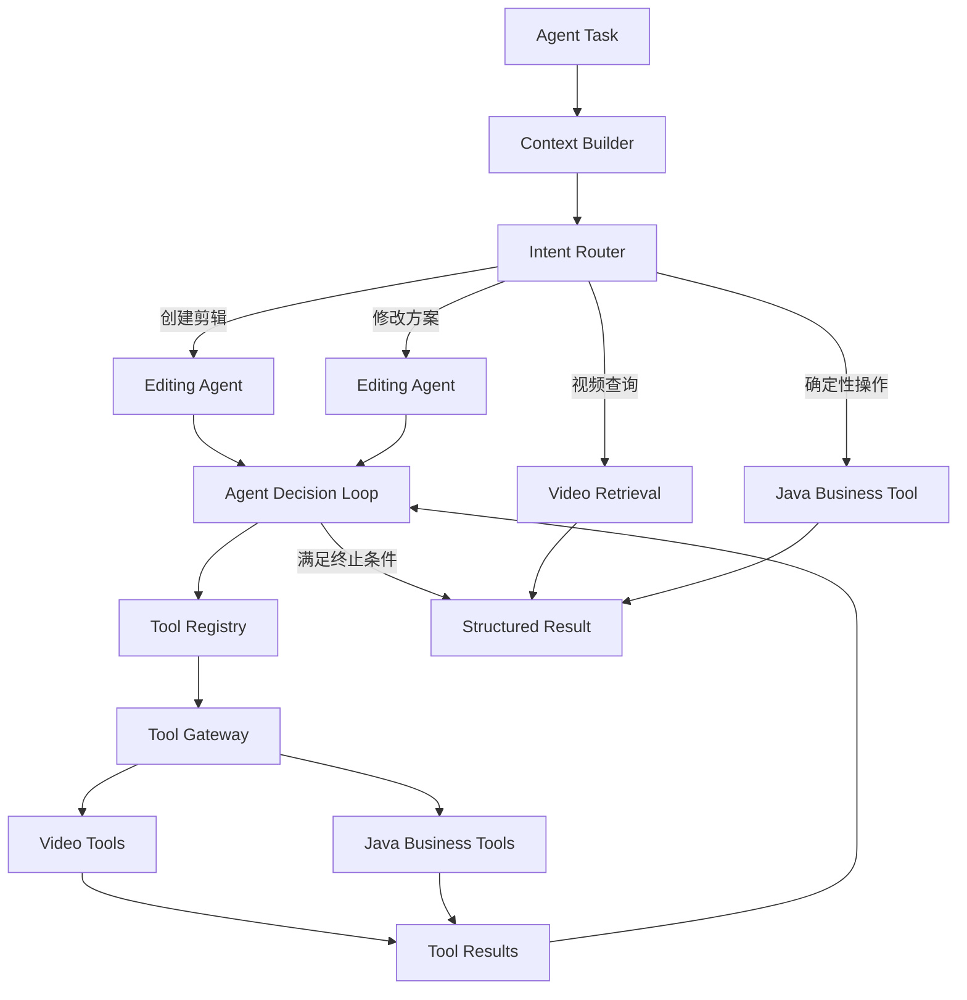

# Agent：剪辑规划与决策循环

负责上下文构建、意图路由、剪辑规划和结构化结果输出；第一版采用单 Agent 与按任务类型组织的子流程。

## 当前状态与边界

**计划中：** 本目录已建立设计文档，尚未初始化工程或实现业务功能。以下内容来自 v0.1 架构预研，章节编号沿用原设计，便于追溯。容量、预算和性能参数均为设计建议，尚无实测结果。

## 必要依赖（设计选型）

Python + LangGraph、LLM；工具注册与执行框架；Java 权威业务上下文；LangGraph Checkpointer。

## 运行与验证

尚无安装、环境准备、启动、格式检查、静态检查、构建或测试命令；构建配置、依赖版本、锁文件和 CI 待工程初始化时确定。初始化后应在所属工程 README 中补充确切命令与工作目录。

本阶段仅可核对文档内容、相对链接与 Markdown 结构，并在仓库根目录执行 `git diff --check`；这些检查不代表功能验证。

## 已知限制

本文保留设计目标和示例，不构成已实现的接口、数据库迁移、JSON Schema 或部署配置。模块功能、故障恢复与集成行为仍待实现和验证。

## 阅读导航

- [系统总览与需求](../../README.md)。
- [Python 工程](../README.md)。
- [工具治理](../tools/README.md)。
- [视频理解与检索](../analysis/README.md)。
- [多轮对话与执行恢复](../../docs/conversation/README.md)。
- [剪辑 DSL](../../backend/timeline/README.md)。

## 6.3 Python Agent Service：智能决策中心

### 6.3.1 架构选择

推荐：

**单 Agent + Tool Calling + LangGraph + 按任务类型组织子流程。**

第一版不采用复杂 Multi-Agent。

原因是：

- 主要任务具有明确的输入输出。
- 工具已经可以提供结构化视频信息。
- 单 Agent 更方便调试。
- 工具治理和状态恢复实现成本较低。
- 以后可以根据需要拆分专业 Agent。

### 6.3.2 Agent 内部结构



### 6.3.3 Agent Loop

建议核心循环采用：

```text
Observe
   ↓
Reason
   ↓
Select Tool
   ↓
Execute
   ↓
Evaluate Result
   ↓
Continue / Finish
```

但是必须设置硬性约束。

例如：

```python
AgentBudget(
    max_steps=12,
    max_tool_calls=20,
    max_deep_inspections=8,
    max_render_previews=3
)
```

这些是初期的建议参数，需要根据实际任务效果和模型成本调整。

Agent 不能通过修改自己的上下文绕过预算。

真正的调用次数和预算必须由工具执行框架记录。

### 6.3.4 Agent 输出规范

Agent 不应该直接输出无法验证的自然语言剪辑方案。

而应该输出以下结构化结果之一：

```text
QUERY_RESULT
EDIT_PLAN_CREATED
EDIT_PLAN_PATCHED
NEED_USER_INPUT
TASK_FAILED
```

例如：

```json
{
  "result_type": "EDIT_PLAN_PATCHED",
  "plan_id": "plan_001",
  "revision": 4,
  "summary": "已缩短第二个镜头并保留结尾",
  "changed_clip_ids": [
    "clip_002"
  ]
}
```

这样 Java 可以基于结果类型执行后续业务逻辑。

---
