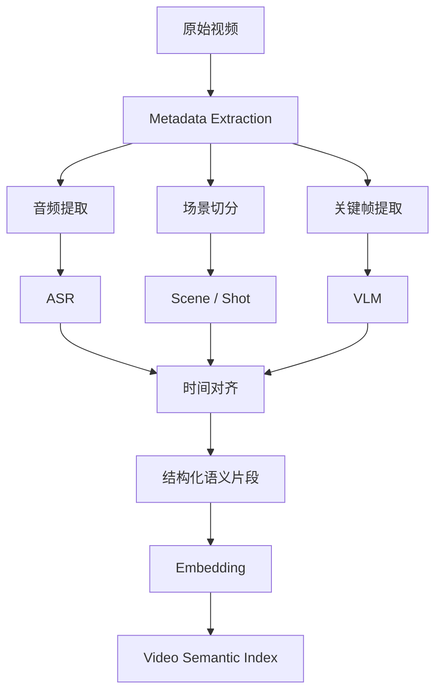

# Analysis：视频理解与语义索引

将视频转换为可检索、可定位的语义片段，提供基础分析、局部精细理解与可重建的片段级索引。

## 当前状态与边界

**计划中：** 本目录已建立设计文档，尚未初始化工程或实现业务功能。以下内容来自 v0.1 架构预研，章节编号沿用原设计，便于追溯。容量、预算和性能参数均为设计建议，尚无实测结果。

## 必要依赖（设计选型）

M2 计划采用 Python、固定 FFmpeg、PySceneDetect、阿里云 Qwen ASR / Qwen3-VL / Qwen3-Embedding 候选、PostgreSQL + pgvector、PGSTY Silo；具体接口/版本待资格核验。后台预处理产出结构化片段、来源证据与文本/向量索引；时间轴、音画关联和 query/document 编码分别对齐，时间共现不代表语义关系已验证。详细流程、产物与检索边界以[M2 计划](../../docs/milestone-2-plan.md)为准。WhisperX 为原预研本地方案，M2 不强制引入词级对齐；具体依赖版本仍待初始化。

[模型接入计划](../../docs/milestone-2-plan.md#33-模型调用协议与统一适配边界)采用 OpenAI SDK 接入经核验的兼容 HTTP 接口，生成类优先 Responses；Embedding 使用专用接口并保留编码角色，ASR 保留必要原生 SDK/WebSocket 协议。generate/transcribe/embed 在 Python 内提供独立结果类型，共享授权、预算与可追踪调用元数据；具体依赖与能力矩阵在 P0/P1 锁定，当前不可运行。

## 运行与验证

尚无安装、环境准备、启动、格式检查、静态检查、构建或测试命令；构建配置、依赖版本、锁文件和 CI 待工程初始化时确定。初始化后应在所属工程 README 中补充确切命令与工作目录。

本阶段仅可核对文档内容、相对链接与 Markdown 结构，并在仓库根目录执行 `git diff --check`；这些检查不代表功能验证。

## 已知限制

本文保留设计目标和示例，不构成已实现的接口、数据库迁移、JSON Schema 或部署配置。模块功能、故障恢复与集成行为仍待实现和验证。

## 阅读导航

- [M2 视频理解与检索计划（尚未实现）](../../docs/milestone-2-plan.md)。

- [系统总览与需求](../../README.md)。
- [Python 工程](../README.md)。
- [分析 Worker](../workers/README.md)。
- [Agent 决策](../agent/README.md)。
- [数据所有权](../../docs/data-model/README.md)。
- [容量与分析成本](../../docs/capacity/README.md)。

## 6.2 Video Understanding：视频理解组件

### 6.2.1 设计目标

该组件负责将原始视频转换成可检索、可定位的视频语义数据。

核心不是生成一句摘要，而是建立：

**视频内容 → 语义片段 → 时间位置 → 原始素材引用**

之间的映射。

### 6.2.2 视频分析 Pipeline



原预研候选如下；M2 云 API 优先，实施取舍以 M2 计划为准：

- FFmpeg：提取视频元数据、音频和关键帧。
- PySceneDetect：场景及镜头边界检测。
- WhisperX：语音识别与词级时间对齐。
- VLM：视觉内容描述与事件理解。
- Embedding：视频语义索引。

需要注意，镜头切分不等于事件切分。

一个语义事件可能跨越多个镜头，也可能发生在一个没有切镜的连续片段中。

因此，系统需要保存不同类型的时间边界。

### 6.2.3 分层索引结构

建议：

```text
Video
│
├── Chapter
│   ├── Scene
│   │   ├── Shot
│   │   └── Shot
│   │
│   └── Event
│       ├── start_ms
│       ├── end_ms
│       ├── description
│       └── evidence
│
└── Transcript
    ├── Segment
    └── Word Timestamps
```

其中：

- Chapter：主题章节。
- Scene：连续场景。
- Shot：镜头。
- Event：语义事件。
- Transcript：语音信息。

它们不一定构成严格的树形包含关系。实际数据库中允许事件跨镜头或跨场景。

### 6.2.4 Agent 按需精细理解

基础分析采用较低的采样密度。

当 Agent 对某个时间范围产生兴趣时，调用：

```python
inspect_segment(
    asset_id="asset_001",
    start_ms=120000,
    end_ms=150000,
    detail_level="fine"
)
```

系统再针对局部范围提高视觉采样密度。

好处是：

- 避免完整长视频的高成本密集分析。
- 支持 Agent 自主探索。
- 提高关键片段的时间定位精度。
- 可以缓存已经完成的分析结果。

同时需要为每条分析结果保存模型版本、采样策略和原始证据引用，方便后续验证与重新分析。

---

## 4.9 Video Segment 与 Embedding

视频理解结果不应该只保存一份完整摘要。

建议采用片段级存储。

**Video Segment：**

```text
id
asset_id
start_ms
end_ms
segment_type
summary
visual_description
event_type
analysis_version
evidence_reference
```

**Video Embedding：**

```text
id
segment_id
embedding_type
model_name
model_version
embedding VECTOR
created_at
```

建议建立：

- `asset_id + start_ms` 索引。
- `project_id` 范围过滤索引。
- 向量近邻检索索引。
- 必要的全文检索索引。

检索流程：

```text
用户自然语言需求
        │
        ▼
Query Embedding
        │
        ▼
按 Project / Asset 过滤
        │
        ▼
向量检索 + 文本检索
        │
        ▼
融合候选结果
        │
        ▼
按需精细分析
```

对于第一版，语义索引属于可重新计算的派生数据。

即使索引损坏，也应该能够通过原始素材重新建立，而不影响用户已保存的剪辑方案。
