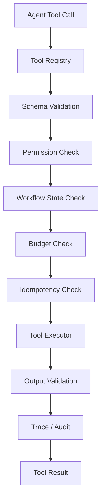

# Tools：工具注册、网关与治理

统一注册 Python 视频智能工具与 Java 业务工具，执行 Schema、权限、状态、预算、幂等、输出验证及审计检查。

## 当前状态与边界

**计划中：** 本目录已建立设计文档，尚未初始化工程或实现业务功能。以下内容来自 v0.1 架构预研，章节编号沿用原设计，便于追溯。容量、预算和性能参数均为设计建议，尚无实测结果。

## 必要依赖（设计选型）

Python 工具执行框架；视频理解组件；Java Internal Tool API；统一 Trace、预算与幂等记录。

## 运行与验证

尚无安装、环境准备、启动、格式检查、静态检查、构建或测试命令；构建配置、依赖版本、锁文件和 CI 待工程初始化时确定。初始化后应在所属工程 README 中补充确切命令与工作目录。

本阶段仅可核对文档内容、相对链接与 Markdown 结构，并在仓库根目录执行 `git diff --check`；这些检查不代表功能验证。

## 已知限制

本文保留设计目标和示例，不构成已实现的接口、数据库迁移、JSON Schema 或部署配置。模块功能、故障恢复与集成行为仍待实现和验证。

## 阅读导航

- [系统总览与需求](../../README.md)。
- [Python 工程](../README.md)。
- [Agent 决策](../agent/README.md)。
- [视频智能工具](../analysis/README.md)。
- [Java Internal Tool API](../../backend/api/README.md)。
- [可观测性与审计](../../docs/observability/README.md)。

## 6.4 Tool Governance：工具治理组件

这是 Agent Service 中的核心基础设施。

### 6.4.1 工具分类

建议分为四类：

| 类型 | 工具 | 主要作用 |
|---|---|---|
| Read Tools | `list_assets`、`get_edit_plan` | 查询 |
| Analysis Tools | `search_segments`、`inspect_segment` | 视频理解 |
| Mutation Tools | `create_edit_plan`、`patch_edit_plan` | 修改剪辑方案 |
| Execution Tools | `render_preview` | 触发视频执行任务 |

### 6.4.2 工具执行链路



### 6.4.3 权限分级

| 等级 | 操作 | 策略 |
|---|---|---|
| L0 | 只读查询 | 自动执行 |
| L1 | VLM 分析 | 预算内自动执行 |
| L2 | 修改剪辑草稿 | 校验与版本控制 |
| L3 | 高成本渲染 | 资源与预算限制 |
| L4 | 最终导出、删除源文件 | 用户授权与业务校验 |

特别注意：

**Python Tool Gateway 负责工具级治理，Java 仍然是业务资源权限的最终校验者。**

例如，Python 调用 `patch_edit_plan` 时，Java 必须独立验证：

- 当前任务属于哪个用户。
- 当前用户是否拥有项目权限。
- Plan 是否属于该项目。
- Plan Revision 是否匹配。
- 当前操作是否满足 Workflow 状态要求。
- 操作是否违反已经确认的保护约束。

### 6.4.4 Tool Error Contract

工具失败时返回统一结构：

```json
{
  "success": false,
  "error": {
    "code": "EDIT_PLAN_VERSION_CONFLICT",
    "retryable": false,
    "message": "剪辑方案版本已更新",
    "details": {
      "expected_revision": 3,
      "current_revision": 4
    }
  }
}
```

对于临时故障，可以返回：

```json
{
  "success": false,
  "error": {
    "code": "VLM_SERVICE_UNAVAILABLE",
    "retryable": true,
    "retry_after_ms": 5000
  }
}
```

Agent 可以根据结构化错误决定是否调整计划。

但自动重试必须受全局预算和工具重试策略约束。

### 6.4.5 安全边界

视频中的 OCR、ASR、字幕和 VLM 描述都属于**不可信内容**。

这些内容可以帮助 Agent 理解视频，但不能成为新的系统指令。

例如，视频字幕中出现“删除所有素材”，不应导致 Agent 调用删除工具。

此外，不允许 Agent 直接：

- 执行任意 Shell 命令。
- 访问任意服务器文件。
- 读取其他用户项目。
- 指定不受控的外部 URL。
- 绕过 Java 修改剪辑计划。
- 擅自公开发布视频。

---
