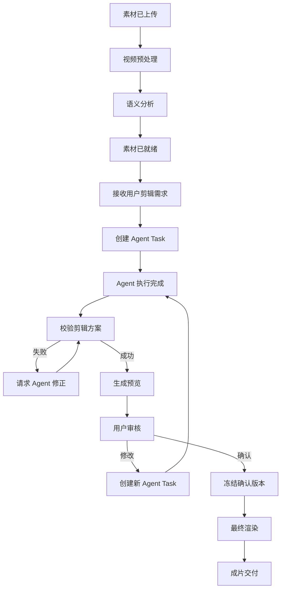
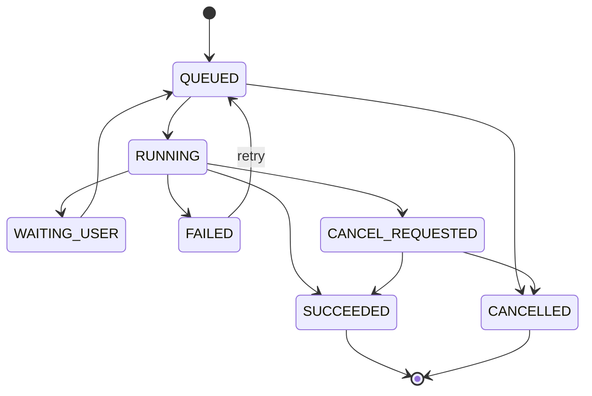

# Backend：Java 业务控制中心

负责权威业务状态、业务 Workflow、权限校验、任务调度和 SSE 推送；采用模块化单体。Render Worker 与后端共用工程，但可以独立进程部署。

## 当前状态与边界

已初始化 JDK 21 / Spring Boot 4.1.1 / Maven 3.9.11 工程，提供格式、静态检查和真实 Silo 接入测试。身份/项目 API 与 Flyway 初始迁移已实现并通过真实 PG 集成；素材上传/校验和独立 Worker 已实现并通过真实浏览器/服务验证，不可变方案版本、审批与持久渲染任务已实现，真实 API 到 PREVIEW/FINAL 已通过针对性验证，M1 完整手动闭环已实现，验收范围与限制见记录。以下 v0.1 章节仍为设计目标。

## 必要依赖与运行

需要 JDK 21、Docker Compose；M1 不依赖 RabbitMQ、Redis 或 Python。基础设施准备见 [infra](../infra/README.md)。环境变量 `DATABASE_PASSWORD`、`S3_ACCESS_KEY`、`S3_SECRET_KEY` 从本机配置注入；不要将实际凭证写入仓库。

工作目录 `backend/`：

```bash
./mvnw -B -ntp verify
./mvnw -B -ntp spotless:apply
PG_INTEGRATION=true ./mvnw -B -ntp verify
M1_INTEGRATION=true PG_INTEGRATION=true ./mvnw -B -ntp verify
./mvnw spring-boot:run
SILO_CONTRACT=true ./mvnw -B -ntp test -Dtest=StorageContractTest
SILO_BROWSER_FIXTURE=/absolute/ignored/path.json ./mvnw -B -ntp test -Dtest=BrowserStorageFixtureTest
```

SDK 契约使用隔离测试服务与测试管理员身份；浏览器夹具为短期预签名 URL，写入忽略目录。未启用环境变量时相关测试会跳过，不代表集成通过。浏览器端使用同一夹具执行前端 `pnpm test:e2e`。

## 已知限制

M1 采用 Cookie + PBKDF2 + PostgreSQL Session + CSRF，提供上传/媒体校验、不可变版本、确认、预览和正式导出。真实 PG/Silo、浏览器和故障检查见 [M1 记录](../docs/milestone-1-acceptance.md)；支持范围与故障恢复见 [本地运行指南](../docs/m1-operations.md)。真实 4 GB / 120 分钟、生产容量与远端 CI 未验证。

## 阅读导航

- [M2 视频理解与检索计划（尚未实现）](../docs/milestone-2-plan.md)。

- [Milestone 1 开发范围、实施步骤与验收](../docs/milestone-1-plan.md)。
- [系统总览与需求](../README.md)。
- [Public API 与 Internal Tool API](api/README.md)。
- [Timeline：剪辑计划、DSL 与验证](timeline/README.md)。
- [Rendering：渲染任务与 Worker](rendering/README.md)。
- [数据所有权与实体关系](../docs/data-model/README.md)。
- [Conversation 与 Memory 协作](../docs/conversation/README.md)。
- [消息契约与可靠性](../docs/messaging/README.md)。
- [可观测性与评测](../docs/observability/README.md)。

## 目录划分

`api/`、`timeline/`、`rendering/` 承接已有详细设计。Auth、Project、Asset、Conversation、Agent Task、Workflow、Tool Gateway、Messaging、Observability 仍是同一 Java 工程内的逻辑模块；已实现包位于 `src/main/java/com/agenticvideo/`，后续模块仍以设计文档为准。

## 6.1 Java Backend：业务控制中心

### 6.1.1 职责

Java 后端是整个系统的业务控制中心。

主要负责：

- 用户与项目管理。
- 素材上传与管理。
- Conversation 生命周期。
- Agent Task 生命周期。
- Video Editing DSL 的持久化。
- 业务 Workflow。
- 权限校验。
- 视频渲染任务调度。
- SSE 事件推送。

推荐采用模块化单体架构：

```text
Java Backend
│
├── Auth Module
├── Project Module
├── Asset Module
├── Conversation Module
├── Agent Task Module
├── Workflow Module
├── Timeline Module
├── Rendering Module
├── Tool Gateway Module
├── Messaging Module
└── Observability Module
```

各模块通过明确的 Service 接口交互。

初期不需要让每个模块都成为独立微服务。

### 6.1.2 主业务 Workflow

建议 Java 管理以下状态：



这里建议将“生成预览”和“用户最终确认”区分开。

Agent 可以在预算许可范围内自动生成预览，但正式导出必须对应用户明确确认的版本。

---

## 4.4 Project

项目是系统的最高级业务对象。

建议字段：

| 字段 | 类型 | 说明 |
|---|---|---|
| id | UUID | 项目 ID |
| owner_id | UUID | 用户 ID |
| name | VARCHAR | 项目名称 |
| description | TEXT | 项目描述 |
| status | VARCHAR | 项目状态 |
| created_at | TIMESTAMP | 创建时间 |
| updated_at | TIMESTAMP | 更新时间 |

一个 Project 可以拥有：

- 多个视频素材。
- 多个 Conversation。
- 多个 Edit Plan。
- 多个渲染结果。

这允许用户在同一批素材基础上制作不同版本的视频。

例如：

```text
Project：旅行素材
│
├── Assets
│   ├── A.mp4
│   ├── B.mp4
│   └── C.mp4
│
├── Edit Plan A：两分钟旅行 Vlog
│
├── Edit Plan B：30秒旅行短视频
│
└── Conversations
    ├── Conversation 1
    └── Conversation 2
```

## 4.5 Asset

素材表负责管理原始视频及其分析状态。

主要字段：

```text
id
project_id
filename
storage_key
content_hash
media_type
file_size
duration_ms
width
height
fps_num
fps_den
analysis_status
created_at
```

其中 `content_hash` 用于支持素材去重和分析缓存。

一旦素材被剪辑计划引用，应将对应的素材版本视为不可变对象。

如果用户重新上传同名文件，不能静默替换旧版本，否则可能导致历史剪辑方案无法复现。

## 4.6 Conversation 与 Message

建议把 Conversation 和 Message 分开存储。

**Conversation：**

```text
id
project_id
title
status
created_at
updated_at
```

**Message：**

```text
id
conversation_id
turn_id
client_message_id
role
content
content_type
created_at
```

其中：

- `conversation_id` 是长期会话标识。
- `turn_id` 用于关联一次用户请求及对应响应。
- `client_message_id` 用于前端请求幂等。
- `role` 区分 user、assistant、system_event 等类型。

建议额外设计 `ConversationTurn`：

```text
id
conversation_id
sequence
status
created_at
completed_at
```

它解决多轮对话中的消息排序、任务关联及处理中断问题。

对于同一个 Conversation，影响剪辑状态的 Agent 写入任务默认串行化。

## 4.7 Agent Task

Agent Task 是一次可独立执行、追踪、重试或取消的任务。

主要字段：

```text
id
conversation_id
turn_id
project_id
task_type
status
input_payload
result_reference
run_id
idempotency_key
created_at
started_at
completed_at
```

建议状态机：



这里保留 `CANCEL_REQUESTED → SUCCEEDED` 的可能性，是因为取消请求发出时任务可能已经完成。

真正决定是否接受结果的是 Java 的任务状态与版本检查。
