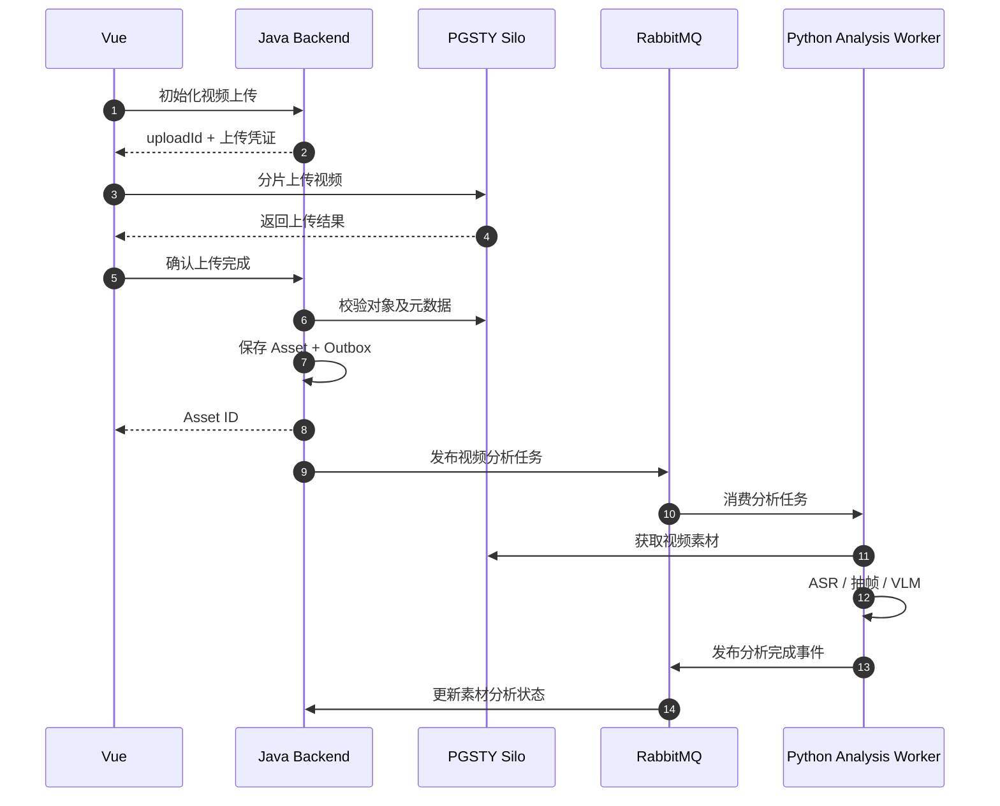

# API：业务接口与内部工具接口

由 Java 提供前端业务接口和 Python Agent 使用的受控内部工具接口；定义接口边界、上传流程、幂等与版本冲突行为。

## 当前状态与边界

M1 OpenAPI 契约已建立；身份与项目端点已实现并通过真实 PG HTTP 集成，上传/素材端点已通过真实服务及浏览器验证，方案、审批与渲染任务端点已实现。以下内容来自 v0.1 架构预研，章节编号沿用原设计，便于追溯。容量、预算和性能参数均为设计建议，尚无实测结果。

## 必要依赖（设计选型）

Spring Boot HTTP API；PGSTY Silo 预签名上传；完整架构使用 RabbitMQ 长任务通信，前端与 Agent Service 是调用方。M1 仅接入前端，以下分析消息与 Python 流程属于后续阶段，M1 接口子集见开发计划。

## 运行与验证

工程命令见所属工程 README。M1 契约与媒体检查见 [验收记录](../../docs/milestone-1-acceptance.md)。

在后端目录执行 `./mvnw -B -ntp verify`；真实集成与浏览器命令见 [验证脚本](../../scripts/README.md)，实际响应按共享 OpenAPI 检查。

## 已知限制

本文旧章节保留后续设计目标；M1 已实现子集以共享规范和 OpenAPI 为准。M1 不支持 Patch、Agent 工具、字幕或多轨道；全量保存产生新 Revision。

M1 新增规范与契约：[DSL 规范](../../docs/specs/m1-dsl.md)、[共享契约](../../contracts/README.md)。旧章节保留后续设计目标。

## 阅读导航

- [Milestone 1 开发范围、实施步骤与验收](../../docs/milestone-1-plan.md)。
- [系统总览与需求](../../README.md)。
- [后端工程](../README.md)。
- [前端调用方](../../frontend/README.md)。
- [Python 工具治理](../../agent-service/tools/README.md)。
- [异步消息契约](../../docs/messaging/README.md)。

## 3.2 API 设计原则

采用三种接口：

**Public API**

面向 Vue 前端，提供业务操作。

**Internal Tool API**

面向 Python Agent，由 Java 实现并进行权限和参数校验。

**Async Message Contract**

用于 Java 与 Python 之间的长任务提交、完成事件和状态同步。

API 路径使用 `/api/v1` 进行版本管理。

消息协议独立使用 `schema_version`。

## 3.3 项目与素材 API

| Method | Endpoint | 功能 |
|---|---|---|
| POST | `/api/v1/projects` | 创建项目 |
| GET | `/api/v1/projects/{id}` | 查询项目 |
| GET | `/api/v1/projects/{id}/assets` | 查询项目素材 |
| POST | `/api/v1/projects/{id}/uploads/init` | 初始化上传 |
| POST | `/api/v1/uploads/{uploadId}/complete` | 完成上传 |
| GET | `/api/v1/assets/{id}` | 查询素材信息 |
| GET | `/api/v1/assets/{id}/analysis` | 查询分析状态 |
| POST | `/api/v1/assets/{id}/analysis/retry` | 重试失败的分析任务 |
| DELETE | `/api/v1/assets/{id}` | 删除素材，需检查引用关系 |

上传流程：



Java 在上传完成时需要检查对象大小、校验和、文件格式及访问权限，不能仅相信前端传递的“上传成功”标志。

## 3.4 Conversation API

这是支持多轮对话的核心接口。

| Method | Endpoint | 功能 |
|---|---|---|
| POST | `/api/v1/projects/{id}/conversations` | 创建会话 |
| GET | `/api/v1/conversations/{id}` | 获取会话 |
| GET | `/api/v1/conversations/{id}/messages` | 分页获取历史消息 |
| POST | `/api/v1/conversations/{id}/messages` | 发送用户消息 |
| GET | `/api/v1/conversations/{id}/events` | SSE 事件流 |
| GET | `/api/v1/agent-tasks/{id}` | 查询 Agent 任务 |
| POST | `/api/v1/agent-tasks/{id}/cancel` | 请求取消任务 |

例如，用户发送：

```http
POST /api/v1/conversations/conv_001/messages
```

```json
{
  "client_message_id": "client_msg_001",
  "content": "把第一个镜头缩短五秒，结尾不要修改",
  "references": {
    "plan_id": "plan_001",
    "expected_revision": 2
  }
}
```

其中：

- `client_message_id` 用于防止网络重试导致重复创建消息。
- `plan_id` 指向当前用户正在编辑的剪辑方案。
- `expected_revision` 用于检测方案版本变化。

Java 返回：

```json
{
  "message_id": "msg_003",
  "turn_id": "turn_003",
  "task_id": "task_003",
  "status": "QUEUED"
}
```

HTTP 状态码为 `202 Accepted`。

**关键约束：一个 Message 不一定对应一个独立的 Agent 执行任务。**

例如“撤销上一次修改”可以由 Java 直接执行，而“换一个更精彩的开头”可能需要运行完整 Agent Loop。

因此，是否创建 Agent Task 应由业务路由决定。

## 3.5 Editing Plan API

| Method | Endpoint | 功能 |
|---|---|---|
| GET | `/api/v1/projects/{id}/edit-plans` | 查询剪辑方案 |
| GET | `/api/v1/edit-plans/{id}` | 获取当前方案 |
| GET | `/api/v1/edit-plans/{id}/revisions` | 获取版本历史 |
| GET | `/api/v1/edit-plans/{id}/revisions/{rev}` | 查询指定版本 |
| PATCH | `/api/v1/edit-plans/{id}` | 修改剪辑方案 |
| POST | `/api/v1/edit-plans/{id}/validate` | 验证剪辑计划 |
| POST | `/api/v1/edit-plans/{id}/approve` | 确认指定版本 |
| POST | `/api/v1/edit-plans/{id}/restore` | 根据历史版本创建新版本 |

修改接口使用乐观锁。

例如：

```http
PATCH /api/v1/edit-plans/plan_001
If-Match: "revision-2"
```

如果当前版本已经是 `revision-3`，返回：

```http
409 Conflict
```

```json
{
  "code": "EDIT_PLAN_VERSION_CONFLICT",
  "expected_revision": 2,
  "current_revision": 3
}
```

这样可以防止用户与 Agent 同时编辑时产生覆盖。

## 3.6 渲染 API

| Method | Endpoint | 功能 |
|---|---|---|
| POST | `/api/v1/render-jobs` | 创建渲染任务 |
| GET | `/api/v1/render-jobs/{id}` | 查询渲染状态 |
| POST | `/api/v1/render-jobs/{id}/cancel` | 请求取消渲染 |
| GET | `/api/v1/render-jobs/{id}/output` | 获取生成视频的授权地址 |

创建渲染任务：

```json
{
  "plan_id": "plan_001",
  "revision": 3,
  "render_profile": "PREVIEW_720P"
}
```

返回：

```json
{
  "job_id": "render_001",
  "status": "QUEUED"
}
```

渲染是异步任务，不通过 HTTP 请求等待视频生成结束。

## 3.7 Internal Tool API

Python Agent 可以调用 Java 提供的受控工具接口：

| Tool | Java Endpoint | 用途 |
|---|---|---|
| `get_project_state` | `GET /internal/projects/{id}/state` | 获取业务上下文 |
| `get_asset_info` | `GET /internal/assets/{id}` | 查询素材 |
| `get_edit_plan` | `GET /internal/edit-plans/{id}` | 查询剪辑计划 |
| `create_edit_plan` | `POST /internal/edit-plans` | 创建计划 |
| `patch_edit_plan` | `POST /internal/edit-plans/{id}/patch` | 修改计划 |
| `validate_edit_plan` | `POST /internal/edit-plans/{id}/validate` | 验证计划 |
| `render_preview` | `POST /internal/render-jobs` | 创建预览任务 |
| `get_render_status` | `GET /internal/render-jobs/{id}` | 查询渲染 |

Python 本地实现的视频智能工具包括：

```text
search_segments
inspect_segment
get_transcript
rank_highlights
```

两个工具集合统一注册到 Python Tool Registry。

但真正执行 Java 业务工具时，Java 必须再次检查权限、资源范围、任务状态和预算授权。
