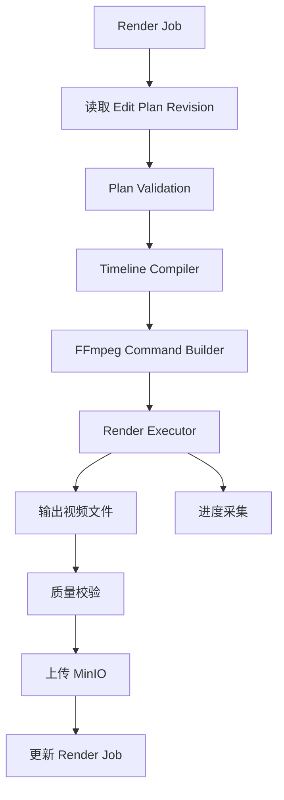

# Rendering：Java Render Worker 与 FFmpeg

负责渲染任务管理、受控 FFmpeg 执行、进度采集、质量校验和产物保存；正式导出绑定用户确认的计划版本、素材版本与输出参数。

## 当前状态与边界

**计划中：** 本目录已建立设计文档，尚未初始化工程或实现业务功能。以下内容来自 v0.1 架构预研，章节编号沿用原设计，便于追溯。容量、预算和性能参数均为设计建议，尚无实测结果。

## 必要依赖（设计选型）

Java + FFmpeg、MinIO、PostgreSQL、RabbitMQ；复用后端的 DSL Validator 与 Timeline Compiler。

## 运行与验证

尚无安装、环境准备、启动、格式检查、静态检查、构建或测试命令；构建配置、依赖版本、锁文件和 CI 待工程初始化时确定。初始化后应在所属工程 README 中补充确切命令与工作目录。

本阶段仅可核对文档内容、相对链接与 Markdown 结构，并在仓库根目录执行 `git diff --check`；这些检查不代表功能验证。

## 已知限制

本文保留设计目标和示例，不构成已实现的接口、数据库迁移、JSON Schema 或部署配置。模块功能、故障恢复与集成行为仍待实现和验证。

## 阅读导航

- [系统总览与需求](../../README.md)。
- [后端工程](../README.md)。
- [DSL 与计划版本](../timeline/README.md)。
- [渲染 API](../api/README.md)。
- [消息拓扑与可靠性](../../docs/messaging/README.md)。

## 4.10 Render Job

建议字段：

```text
id
project_id
plan_id
plan_revision
plan_hash
render_profile
status
progress
output_storage_key
idempotency_key
error_code
started_at
completed_at
```

渲染任务必须绑定不可变的剪辑计划版本和对应输入素材版本。

否则，渲染过程中如果用户继续修改时间线，就可能出现成片与用户确认方案不一致的问题。

## 6.8 Rendering：视频渲染组件

### 6.8.1 技术方案

推荐：

**Java RenderService + Java Render Worker + FFmpeg。**

其中：

- RenderService：创建任务、校验版本、分配资源。
- Timeline Compiler：将 DSL 转换成 FFmpeg 操作。
- FFmpeg Executor：执行外部视频处理进程。
- Render Monitor：读取进度、处理异常。
- Output Manager：保存成片与产物信息。



### 6.8.2 为什么不用 Python 渲染？

因为视频渲染主要依赖 FFmpeg，并不强制依赖 Python。

Java 可以通过 `ProcessBuilder` 安全地启动受控的 FFmpeg 子进程。

FFmpeg 支持 `-progress` 参数，以机器可解析的键值对格式输出编码进度，适合后端采集渲染状态。[FFmpeg](https://ffmpeg.org/ffmpeg.html?utm_source=chatgpt.com)

### 6.8.3 资源隔离

渲染任务可能大量占用：

- CPU。
- 内存。
- 磁盘 I/O。
- 临时存储。
- 编码器资源。

因此推荐：

- Render Worker 与 Web API 进程解耦。
- 限制单 Worker 并发数。
- 限制单任务执行时间。
- 限制临时目录大小。
- 取消任务时终止对应 FFmpeg 子进程。
- 定期清理失败任务的临时文件。

渲染进程应使用可信的参数数组启动，而不是执行 LLM 生成的任意 Shell 字符串。

### 6.8.4 预览与正式渲染

建议区分：

| 渲染类型 | 用途 |
|---|---|
| PREVIEW | 低分辨率、快速预览 |
| FINAL | 根据用户确认方案正式导出 |

例如：

```text
Preview：720p
Final：1080p
```

两者可以共享相同的 DSL 和 Timeline Compiler。

**但正式渲染必须绑定用户确认的计划版本、素材版本和输出参数。**

否则可能出现用户确认 A，系统实际渲染 B 的问题。

---
