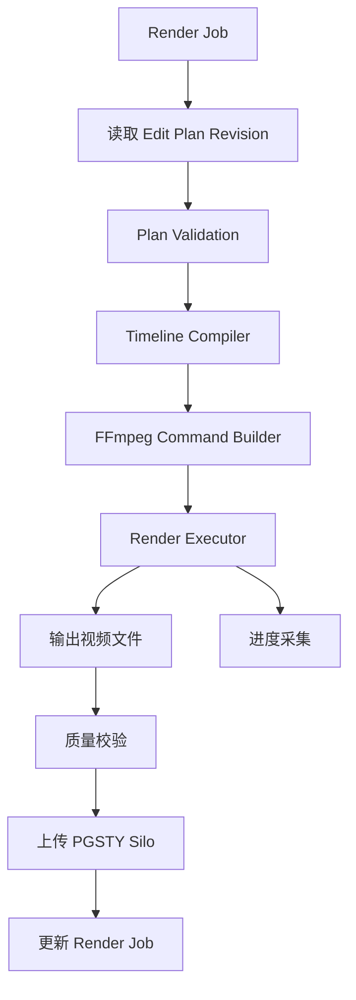

# Rendering：Java Render Worker 与 FFmpeg

负责渲染任务管理、受控 FFmpeg 执行、进度采集、质量校验和产物保存；正式导出绑定用户确认的计划版本、素材版本与输出参数。

## 当前状态与边界

受控 ProcessRunner、MediaProbe 与 FFmpegExecutor 已实现并执行合成媒体实验；持久 RenderJob、审批绑定、幂等提交/重试、取消、进度与租约 Worker 已实现；真实 PREVIEW/FINAL 与运行取消集成已通过，超时、失租、服务/磁盘故障和输出提交回归见验收记录。以下内容来自 v0.1 架构预研，章节编号沿用原设计，便于追溯。容量、预算和性能参数均为设计建议，尚无实测结果。

## 必要依赖（设计选型）

Java + FFmpeg、PGSTY Silo、PostgreSQL；复用后端的 DSL Validator 与 Timeline Compiler。M1 通过 PostgreSQL 持久任务调度独立 Worker，完整架构中的 RabbitMQ 接入留到 M4。

## 运行与验证

工程命令见所属工程 README。M1 契约与媒体检查见 [验收记录](../../docs/milestone-1-acceptance.md)。

在后端目录使用 `M1_INTEGRATION=true ./mvnw -B -ntp verify`；需真实 PG、Silo 和固定 FFmpeg Worker。超时专用测试设置 `M1_TIMEOUT_INTEGRATION=true` 并使用两秒期限的隔离 Worker。

## 已知限制

以下旧章节保留后续设计目标；M1 已实现接口以共享 OpenAPI、迁移与验收记录为准。进程与服务故障使用隔离测试项目；命令见 [验证脚本](../../scripts/README.md)。

M1 新增规范与契约：[DSL 规范](../../docs/specs/m1-dsl.md)、[共享契约](../../contracts/README.md)。旧章节保留后续设计目标。

## M1 资源与任务默认值

项目待处理任务上限 5、用户 10；运行任务租约 30 秒，心跳 1 秒，渲染总期限 1800 秒，任务磁盘预算 32 GB。磁盘预估为去重源字节数 + 输出毫秒数 × 5600 字节 + 512 MiB；对应两份 20 Mb/s 视频、PCM 音频及开销。Worker 并发默认 1，允许 1–4；同一进程全部任务共享磁盘预算。配置见 [运行指南](../../docs/m1-operations.md)，默认值不是容量实测承诺。

成功提交包含 Revision、plan_hash、profile、输出 SHA-256、实际字节数、FFmpeg 版本与 Compiler 配置哈希；只有已授权 SUCCEEDED 任务返回 300 秒签名地址。

## 阅读导航

- [Milestone 1 开发范围、实施步骤与验收](../../docs/milestone-1-plan.md)。
- [系统总览与需求](../../README.md)。
- [后端工程](../README.md)。
- [DSL 与计划版本](../timeline/README.md)。
- [渲染 API](../api/README.md)。
- [消息拓扑与可靠性](../../docs/messaging/README.md)。

## 4.10 Render Job

建议字段：

```text
id
project_id
plan_id
plan_revision
plan_hash
render_profile
status
progress
output_storage_key
idempotency_key
error_code
started_at
completed_at
```

渲染任务必须绑定不可变的剪辑计划版本和对应输入素材版本。

否则，渲染过程中如果用户继续修改时间线，就可能出现成片与用户确认方案不一致的问题。

## 6.8 Rendering：视频渲染组件

### 6.8.1 技术方案

推荐：

**Java RenderService + Java Render Worker + FFmpeg。**

其中：

- RenderService：创建任务、校验版本、分配资源。
- Timeline Compiler：将 DSL 转换成 FFmpeg 操作。
- FFmpeg Executor：执行外部视频处理进程。
- Render Monitor：读取进度、处理异常。
- Output Manager：保存成片与产物信息。



### 6.8.2 为什么不用 Python 渲染？

因为视频渲染主要依赖 FFmpeg，并不强制依赖 Python。

Java 可以通过 `ProcessBuilder` 安全地启动受控的 FFmpeg 子进程。

FFmpeg 支持 `-progress` 参数，以机器可解析的键值对格式输出编码进度，适合后端采集渲染状态。[FFmpeg](https://ffmpeg.org/ffmpeg.html?utm_source=chatgpt.com)

### 6.8.3 资源隔离

渲染任务可能大量占用：

- CPU。
- 内存。
- 磁盘 I/O。
- 临时存储。
- 编码器资源。

因此推荐：

- Render Worker 与 Web API 进程解耦。
- 限制单 Worker 并发数。
- 限制单任务执行时间。
- 限制临时目录大小。
- 取消任务时终止对应 FFmpeg 子进程。
- 定期清理失败任务的临时文件。

渲染进程应使用可信的参数数组启动，而不是执行 LLM 生成的任意 Shell 字符串。

### 6.8.4 预览与正式渲染

建议区分：

| 渲染类型 | 用途 |
|---|---|
| PREVIEW | 低分辨率、快速预览 |
| FINAL | 根据用户确认方案正式导出 |

例如：

```text
Preview：720p
Final：1080p
```

两者可以共享相同的 DSL 和 Timeline Compiler。

**但正式渲染必须绑定用户确认的计划版本、素材版本和输出参数。**

否则可能出现用户确认 A，系统实际渲染 B 的问题。

---
