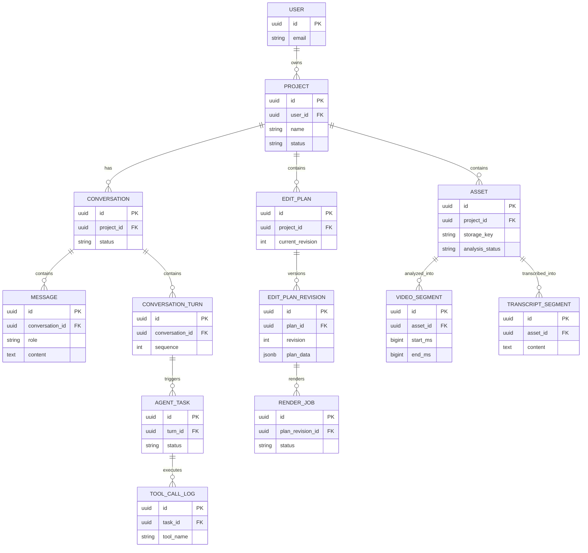

# 数据基础设施、所有权与实体关系

维护跨服务数据选型、Schema 所有权和核心实体关系；各模型的字段与行为由所属模块文档维护。

## 当前状态与边界

**计划中：** 本目录已建立设计文档，相关工程尚未初始化，业务功能尚未实现。以下内容来自 v0.1 架构预研，章节编号沿用原设计，便于追溯。容量、预算和性能参数均为设计建议，尚无实测结果。

## 必要依赖（设计选型）

PostgreSQL + pgvector、Redis、PGSTY Silo、RabbitMQ、LangGraph Checkpointer；尚无 SQL 迁移和实际 Schema。

## 文档验证

本文无需安装或启动。修改后核对设计内容、相对链接、Markdown 结构及示例，在仓库根目录执行 `git diff --check`。相关工程的安装、启动、构建和测试命令尚待初始化；性能与集成行为需后续实测。

## 已知限制

本文保留设计目标和示例，不构成已实现的接口、数据库迁移、JSON Schema 或部署配置。模块功能、故障恢复与集成行为仍待实现和验证。

## 阅读导航

- [系统总览与需求](../../README.md)。
- [文档索引](../README.md)。
- [Project、Asset、Conversation、Message 与 Agent Task](../../backend/README.md)。
- [Edit Plan、Revision 与 DSL 示例](../../backend/timeline/README.md)。
- [Video Segment 与 Embedding](../../agent-service/analysis/README.md)。
- [Render Job](../../backend/rendering/README.md)。
- [Outbox 与 Inbox](../messaging/README.md)。

## 4. 设计数据模型与数据库选型

### 4.1 数据库选型

建议采用以下数据基础设施：

| 技术 | 保存的数据 | 选择原因 |
|---|---|---|
| PostgreSQL | 用户、项目、会话、任务、剪辑计划 | 支持事务、约束、JSONB |
| pgvector | 视频片段语义向量 | 与 PostgreSQL 结合，减少基础设施复杂度 |
| Redis | 缓存、限流、短期协调状态 | 低延迟访问 |
| PGSTY Silo | 原始视频、音频、关键帧、输出视频 | 适合大文件对象存储 |
| RabbitMQ | 任务命令与业务事件 | 异步解耦、确认与重试 |
| LangGraph Checkpointer | Agent 执行状态 | 线程恢复与持久化 |

初期不建议再增加 Elasticsearch、独立向量数据库或多个不同的关系数据库。

**PostgreSQL + pgvector 已经足够支撑第一版的视频语义检索。**

当未来片段数量、向量规模或复杂检索需求明显增长时，再评估专用检索系统。

### 4.2 数据所有权

Java 与 Python 可以共享一套 PostgreSQL 实例，但需要明确数据所有权。

建议按照 Schema 进行隔离：

```text
PostgreSQL
│
├── business_schema
│   ├── users
│   ├── projects
│   ├── assets
│   ├── conversations
│   ├── conversation_messages
│   ├── conversation_turns
│   ├── agent_tasks
│   ├── edit_plans
│   ├── edit_plan_revisions
│   ├── render_jobs
│   ├── outbox_events
│   └── inbox_events
│
└── agent_schema
    ├── video_segments
    ├── transcript_segments
    ├── video_embeddings
    ├── analysis_jobs
    ├── agent_runs
    ├── tool_call_logs
    └── langgraph_checkpoints
```

约束：

- Java 不直接修改 Python 的 Agent 执行状态。
- Python 不直接修改 Java 的业务表。
- 剪辑计划始终由 Java 管理。
- Agent 通过 Internal Tool API 读取或修改剪辑方案。
- 两边的数据关联依赖稳定的业务 ID。

### 4.3 核心实体关系



这是核心实体关系图，不包含全部外键、关联表和审计字段。
