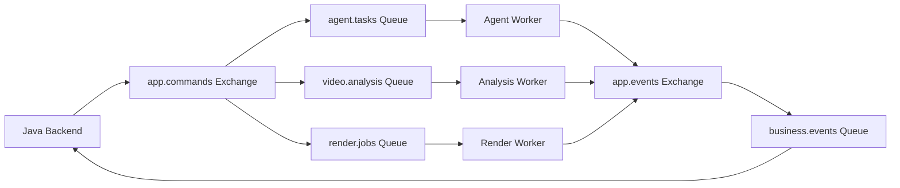

# Messaging：RabbitMQ 消息契约与可靠性

维护 Java、Python、Analysis Worker、Render Worker 共用的消息 Envelope、拓扑、可靠交接、幂等、重试和顺序一致性设计。

## 当前状态与边界

**计划中：** 本目录已建立设计文档，相关工程尚未初始化，业务功能尚未实现。以下内容来自 v0.1 架构预研，章节编号沿用原设计，便于追溯。容量、预算和性能参数均为设计建议，尚无实测结果。

## 必要依赖（设计选型）

RabbitMQ、Java / Python 持久化任务、各服务 Outbox / Inbox、Worker Checkpoint 与心跳租约。

## 文档验证

本文无需安装或启动。修改后核对设计内容、相对链接、Markdown 结构及示例，在仓库根目录执行 `git diff --check`。相关工程的安装、启动、构建和测试命令尚待初始化；性能与集成行为需后续实测。

## 已知限制

本文保留设计目标和示例，不构成已实现的接口、数据库迁移、JSON Schema 或部署配置。模块功能、故障恢复与集成行为仍待实现和验证。

## 阅读导航

- [系统总览与需求](../../README.md)。
- [文档索引](../README.md)。
- [Java 业务控制](../../backend/README.md)。
- [Python Worker](../../agent-service/workers/README.md)。
- [Render Worker](../../backend/rendering/README.md)。
- [对话与任务状态](../conversation/README.md)。

## 3.8 RabbitMQ 消息契约

第一版建议使用以下消息类型：

| 消息类型 | 方向 | 用途 |
|---|---|---|
| `video.analysis.requested` | Java → Python | 创建素材分析任务 |
| `video.analysis.completed` | Python → Java | 分析成功 |
| `video.analysis.failed` | Python → Java | 分析失败 |
| `agent.task.requested` | Java → Python | 创建 Agent 执行任务 |
| `agent.task.progress` | Python → Java | 汇报阶段性进展 |
| `agent.task.completed` | Python → Java | Agent 执行成功 |
| `agent.task.failed` | Python → Java | Agent 执行失败 |
| `agent.task.input_required` | Python → Java | 需要用户补充信息 |
| `agent.task.cancel.requested` | Java → Python | 请求取消 Agent |
| `render.job.requested` | Java → Render Worker | 创建渲染任务 |
| `render.job.completed` | Render Worker → Java | 渲染完成 |

统一消息 Envelope：

```json
{
  "event_id": "evt_1001",
  "event_type": "agent.task.requested",
  "schema_version": 1,
  "occurred_at": "2026-10-08T10:00:00Z",

  "correlation_id": "task_001",
  "causation_id": "turn_001",
  "project_id": "project_001",
  "conversation_id": "conv_001",
  "task_id": "task_001",

  "payload": {
    "instruction": "生成三条精彩短视频",
    "asset_ids": ["asset_001"],
    "expected_plan_revision": null
  }
}
```

`correlation_id` 用于关联一个任务的完整执行链路，`causation_id` 记录触发当前事件的上游操作。

消息中只保存必要的 ID、指令、约束和状态引用，不保存完整视频文件、图像或大型分析结果。

---

## 4.11 Outbox 与 Inbox

建议 Java 和 Python 各自维护消息可靠性记录。

**Outbox：**

记录等待发布到 RabbitMQ 的事件。

```text
event_id
aggregate_id
event_type
payload
status
created_at
published_at
```

**Inbox：**

记录已经处理过的消息。

```text
consumer_name
event_id
processed_at
result_status
```

这样可以通过幂等处理实现业务层面的“有效一次”效果，而不是错误地假设消息队列能够保证所有业务操作恰好执行一次。

---

## 6.7 RabbitMQ：异步消息与可靠性

### 6.7.1 设计目标

RabbitMQ 负责解耦：

- Java 业务 Workflow。
- Python Agent 执行。
- Python 视频分析。
- Java 视频渲染。

但不负责保存业务状态。

**消息队列是传递任务和事件的通道，不是系统的权威数据库。**

### 6.7.2 推荐消息拓扑



第一版将命令队列按计算负载分开。

原因是：

- Agent 对话任务需要较快响应。
- 视频分析可能持续较长时间。
- 渲染任务可能占用大量 CPU。

如果混在同一个队列中，容易出现长任务阻塞短任务。

### 6.7.3 消息可靠性

建议实现：

**Transactional Outbox**

Java 在数据库事务中创建任务并写入 Outbox，再由发布器投递到 RabbitMQ。

**Publisher Confirms**

确认消息被 Broker 接收。

**Manual Acknowledgement**

Consumer 在完成可靠的任务交接后 ACK。

RabbitMQ 官方文档明确区分 Publisher Confirms 与 Consumer Acknowledgements，两者分别负责消息发布和消费侧的可靠性。[RabbitMQ](https://www.rabbitmq.com/docs/confirms?utm_source=chatgpt.com)

**Inbox Deduplication**

使用 `event_id` 判断消息是否已经处理。

**Retry + DLQ**

失败后按错误类型重试，超过最大次数进入死信处理流程。

### 6.7.4 长任务处理方式

不建议让 Python Consumer 在整个长时间 Agent Loop 运行期间一直持有未确认消息。

推荐：

```text
RabbitMQ Command
       │
       ▼
Python Consumer
       │
       ▼
持久化 Agent Run
       │
       ▼
ACK 消息
       │
       ▼
Agent Worker 执行
       │
       ▼
Checkpoint / Heartbeat
       │
       ▼
任务完成
       │
       ▼
Outbox 发布完成事件
```

这里的 ACK 前提是 Agent Run 已经可靠持久化，并能够由 Worker 恢复。

还需要有任务租约、心跳和超时扫描机制，避免 Worker 崩溃后任务永远停留在 `RUNNING`。

### 6.7.5 消息顺序与一致性

RabbitMQ 不应成为解决所有业务顺序问题的唯一手段。

推荐使用：

- Conversation Turn Sequence。
- Agent Task Generation。
- Edit Plan Revision。
- 乐观锁。
- Inbox 去重。
- 过期结果检查。

比如 Agent Task A 生成 Revision 3 后，用户已经修改出了 Revision 4。

那么 A 延迟返回的结果不能再直接覆盖 Revision 4。

无论事件以什么顺序到达，Java 都必须校验当前业务版本。

---
