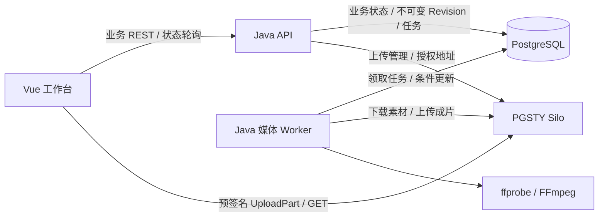

# Milestone 1 开发计划：确定性视频编辑闭环

**日期：** 2026-10-08。**状态：** 计划中；本轮仅完成规划与设计选型同步，业务工程、接口、Schema、迁移、脚本和 CI 均尚未实现或验证。

本计划落实[根 README 第 7.4 节](../README.md)的 Milestone 1。需求与总体架构以根 README 为入口，M1 的范围、实施顺序和验收条件在本文维护。后续实现发现关键假设失效时，先更新本文和所属模块设计，再继续开发。

## 1. 目标与范围

用户能够登录、创建项目、上传视频，在 Vue 工作台通过素材选择与起止时间输入生成 Editing DSL，保存方案并生成预览，确认指定版本后导出 MP4。后端也支持直接提交合法 DSL，以独立验证确定性执行能力。

| 能力 | M1 交付 | 边界 |
|---|---|---|
| 工程基础 | Vue、Spring Boot、PostgreSQL、Silo、Java 媒体 Worker、开发环境和 CI | Python 工程在 M2/M3 初始化 |
| 用户与项目 | 最小注册、登录、登出、项目列表与创建、所有权检查 | 无第三方登录、找回密码、团队共享 |
| 素材 | 分片直传、分片重试、上传取消、元数据校验、素材列表、授权预览、删除 | 无 ASR、抽帧、场景切分和语义索引 |
| DSL | 单视频轨道、多个素材裁切与顺序拼接、源音频、中心裁切或留边 | 不支持留白、重叠、多轨道、转场、变速、字幕、配乐 |
| 方案 | 不可变 Revision、完整 DSL 提交、乐观锁、版本读取、指定版本确认 | Patch 操作、历史恢复和对话编辑留到 M5 |
| 渲染 | 异步预览与导出、进度轮询、取消、超时、失败原因、下载 | RabbitMQ、Outbox/Inbox、SSE 留到 M4 |
| 可靠性 | PostgreSQL 持久任务、原子领取、租约过期终止、幂等创建、清理重试 | 不承诺跨服务恰好一次、编码续跑或自动重试全部失败 |

最小注册登录用于满足已有 P0 项目隔离要求；M1 的版本存储与确认用于保证预览和导出一致。M5 继续增加对话驱动的版本协作。本计划细化分阶段实现方式，不改变后续 Java 权威管理、RabbitMQ 异步通信及 Python Agent 的总体边界。

初始产品限制沿用根 README 的建议值：单素材 4 GB（十进制字节）、120 分钟，单项目 30 个素材、累计 180 分钟，输出不超过 10 分钟。实施时将其做成配置并验证边界；这些值不是现有能力或性能承诺。

## 2. 验收条件

| ID | 可观察结果 | 验证方式 |
|---|---|---|
| AC01 | 全新开发环境按文档启动前端、API、Worker、PG、Silo；无需模型账号 | 从空测试卷执行初始化与冒烟 |
| AC02 | 两个用户仅能访问各自项目、上传会话、素材、方案、任务和授权地址 | HTTP 权限测试与浏览器回归 |
| AC03 | 浏览器上传两个视频，失败分片可单独重传；完成后得到真实元数据和不可变素材 | 真实 Silo + 浏览器直传测试 |
| AC04 | 合法 DSL 保存后，按指定区间、顺序、画幅生成预览与最终视频 | 色块、烧录时间码、音调等合成素材验证 |
| AC05 | 非法 DSL 返回字段路径和稳定错误码，不创建可执行任务 | Schema、权限、引用、时间线边界测试 |
| AC06 | 保存新版产生新 Revision；旧 Revision 保留；过期版本写入返回 409 | 数据库与接口并发测试 |
| AC07 | 未确认版本不能 FINAL；确认 R1 后新增 R2，R1 成片仍绑定 R1 | API 集成与浏览器完整流程 |
| AC08 | 上传完成、保存方案及创建任务的网络重试不会重复产生业务结果 | 同键重放、不同请求同键冲突测试 |
| AC09 | 任务查询显示进度及失败原因；取消/超时终止 FFmpeg；刷新页面恢复状态 | Worker 进程测试和端到端测试 |
| AC10 | Worker 被终止后，任务最终进入明确失败状态，旧执行不能回写成功；QUEUED 任务可被新 Worker 领取 | 租约与进程故障测试 |
| AC11 | 完成产物可播放、跳转和下载，音视频同步、时长及尺寸符合约定 | ffprobe、实际解码和浏览器播放检查 |
| AC12 | 格式、静态检查、编译、构建、单元/集成/端到端检查通过；命令和限制均写入文档 | CI 与最终验收报告 |

“确定性”指同一 Revision、输入素材和渲染环境产生符合相同时间线语义的作品，不要求不同平台的 H.264 编码结果逐字节一致。正确性以帧内容、时间边界、音频与输出参数为准。

## 3. 技术与部署决策

| 部分 | 计划选择 | 落地要求 |
|---|---|---|
| 后端 | JDK 21、Spring Boot 4.1.x、Maven Wrapper | S0 锁定维护版本，验证所有依赖兼容；不使用 Snapshot |
| 数据访问 | Spring JDBC + 显式事务、Flyway | 便于控制版本提交、任务领取和条件更新；无需引入多个持久层 |
| 登录 | Spring Security + PostgreSQL 中的 Spring Session JDBC | 同源 Cookie 会话、密码哈希、CSRF 防护；避免额外 Redis 依赖 |
| 对象存储客户端 | AWS SDK for Java v2 S3 + Presigner | 通过 S3 协议适配 Silo，业务层只依赖 ObjectStorage 接口 |
| 前端 | Vue 3、TypeScript、Vite、Vue Router、Node 24 LTS、pnpm | 精确版本、packageManager、锁文件和运行时版本配置在 S0 生成 |
| 媒体 | FFmpeg + ffprobe，CPU libx264/AAC | 固定 Worker 镜像版本，检查编码器与过滤器；禁用硬件编码作为验收基线 |
| 测试 | JUnit、PG/Silo 集成测试、Vitest、Playwright | 集成测试使用真实服务；CI 配置单独的媒体和浏览器验收 |
| 运行 | Docker Compose；API 与 Worker 使用同一后端工程的不同入口 | Worker 不启动公共业务 API；源码模块保持模块化单体 |

Spring Boot 官方[系统要求](https://docs.spring.io/spring-boot/system-requirements.html)支持上述 JDK 路线，Node 官方[版本表](https://nodejs.org/en/about/previous-releases)将 Node 24 列为 LTS。具体补丁版本及依赖解析结果在 S0 实测后记录；表中选择不代表构建已通过。

2026-10-08 本机只读检查：默认 JDK 17.0.18、Node 25.9.0、pnpm 11.24.0、Docker Engine 29.4.2（linux/arm64）、FFmpeg 8.1；Docker daemon 可连接。初始化时提供项目级 JDK 21/Node 24 配置或容器路径，避免依赖或替换全局工具链。当前工具可执行不等于项目已运行。

M1 运行路径：

## 4. PGSTY Silo 替代 MinIO

用户已指定可采用 PGSTY Silo；M1 以其作为对象存储默认实现。官方 MinIO 仓库已显示[归档状态](https://github.com/minio/minio)。Silo 声明保留 S3、`MINIO_*` 配置和存储格式兼容；依据其[兼容性说明](https://silo.pgsty.com/compatibility/)，应用继续依赖 S3 协议。

初始候选为 `docker.io/pgsty/silo:RELEASE.2026-09-16T00-00-00Z`，来自[正式发布](https://github.com/pgsty/silo/releases/tag/RELEASE.2026-09-16T00-00-00Z)与[组件版本表](https://silo.pgsty.com/compatibility/versions/)。仓库 README 的发布摘要存在滞后，选型以具体发布与版本表交叉核对。S0 核实镜像可获取、arm64/amd64 支持和摘要后固定 tag + digest；不使用 `latest`，不假定主分支修复已进入镜像。

接入规则：

1. PostgreSQL 存 bucket/key、版本与内容哈希，不保存永久下载 URL；私有 bucket 拒绝匿名访问。
2. `ObjectStorage` 提供分片初始化、签名、完成、取消、HEAD、流式读写、受控复制、删除及授权 GET；不依赖 Silo 管理控制台完成业务。
3. 分离 Worker/API 内部 endpoint 与浏览器可访问 endpoint；签名时使用最终 Host，签名后不改写 URL，统一 region 和 path-style 设置。
4. Silo 原生变量 `MINIO_ROOT_USER`、`MINIO_ROOT_PASSWORD` 按上游兼容接口保留；应用使用独立最小权限凭证，前端仅持有短期授权 URL。
5. CORS 仅允许实际前端来源与需要的方法/头，暴露 `ETag`；验证预检、分片 PUT、Range GET 与过期签名。凭证和签名 URL 不写入日志。
6. 初始化 bucket、应用身份、策略和 CORS 的过程可重复执行。测试数据、卷、对象前缀与开发数据分开。

S0 必须使用真实 Silo 验证 multipart、预签名 UploadPart/GET、HEAD、CopyObject、Abort、删除、CORS、Range、过期和错误签名；Java 与浏览器都参与验证。仅 SDK 单测或官方兼容声明不足以放行。

仓库尚无 MinIO 部署与数据，因此本次是选型替换，不执行数据迁移。如后续发现现有部署，先单独盘点数据、备份和回滚路径，再制定迁移方案。

## 5. 素材与上传链路

1. 初始化上传时验证用户、项目、文件声明与配额，在数据库预留素材数量和字节配额，生成 UploadSession、随机 storage key 和 S3 multipart upload ID。
2. 浏览器按计划分片大小直传；按需获取短期分片 URL，记录 part number/ETag；仅失败分片重试，提供上传进度与取消。M1 支持当前会话重试，不承诺刷新后的本地文件自动续传。
3. `complete` 由 Java 验证分片列表与上传归属并调用 S3 完成操作，HEAD 核对实际大小；ETag 不作为完整文件的 SHA-256。重复提交返回同一 Asset/处理任务。
4. 完成上传后创建待验证 Asset 与持久化媒体校验任务，HTTP 返回 202。媒体 Worker 流式下载，计算 SHA-256，用 ffprobe 读取真实容器、流、时长、尺寸、帧率、旋转信息；必要时进行受限解码验证。
5. 使用 staging key 与独立的不可变素材 key；服务端封存对象，客户端不能覆写。封存后校验通过才进入 MEDIA_READY；媒体校验状态与未来 Python 的 `analysis_status` 分开。
6. 素材内容必须有可解码视频；M1 明确支持 MP4/MOV 的 H.264 视频和可选 AAC 音频、横竖屏、旋转元数据和 VFR 输入。无音频生成静音轨；多视频流、多音轨、HDR 和未支持 codec 返回明确不支持错误。
7. 文件损坏、实际大小不符、超时或配额超限返回稳定错误。原子配额检查计入处理中素材与上传预留；实际时长在探测后核对项目总时长，失败释放预留。
8. 未被任何 Revision 或活动任务引用的素材允许删除；先标记 DELETING 阻止新引用，再删除对象，失败可重试，成功后标记 DELETED。版本提交与删除使用事务锁避免竞争。

媒体校验任务状态采用 `QUEUED → RUNNING → SUCCEEDED / FAILED / CANCELLED`；Asset 使用 `VALIDATING / MEDIA_READY / INVALID / DELETING / DELETED`。上传会话另设 `INITIATED / COMPLETING / COMPLETED / ABORTED / EXPIRED / FAILED`，不把语义分析成功当作 M1 可剪辑前提。

DB 与 S3 不组成原子事务：完成前落盘意图，崩溃后按 UploadSession 和固定对象 key 核对 S3 状态；任务/Asset 创建使用唯一约束。过期分片、孤立 staging 对象和失败临时文件按本任务归属与 TTL 清理，已引用源素材和已交付成片不自动删除。

源视频浏览器预览需验证容器可播放；MOV 或其他浏览器不兼容输入由 Java 媒体 Worker 生成轻量 MP4 代理，代理绑定同一 Asset 版本，不替换原始素材。

## 6. DSL、Revision 与确认

以[现有 DSL 示例](../backend/timeline/README.md)为基础实现 `schema_version: "1.0"` 的 M1 子集，在编码前产出规范、JSON Schema 与合法/非法样例。

| 字段/规则 | M1 约定 |
|---|---|
| 身份与版本 | `plan_id`、`revision` 由服务端生成；创建正文提交 DSL 内容，更新携带预期 Revision |
| 素材引用 | `asset_id + asset_version`；M1 每次上传创建新 Asset/version=1，同名上传不覆写 |
| 视频轨道 | 恰好一个 `type=video` 轨道、至少一个 clip；clip/track ID 唯一 |
| 时间 | 毫秒整数、半开区间 `[source_in_ms, source_out_ms)`；数组顺序必须与时间线顺序一致 |
| 起止 | `0 <= in < out <= duration_ms`；从源视频归一化播放时间轴计时，处理非零 PTS |
| 时间线 | 首 clip 从 0 开始，后续 `timeline_start_ms` 精确等于之前片段累计时长；拒绝留白和重叠 |
| 画幅 | 16:9 / 9:16；FINAL 为 1920×1080 / 1080×1920；PREVIEW 为 1280×720 / 720×1280 |
| 帧率和编码 | 输出固定 30/1 fps、H.264、AAC 48 kHz 双声道、yuv420p、MP4 faststart |
| 缩放 | `crop_mode=center` 中心裁切，`crop_mode=fit` 等比缩放黑边；先应用旋转，再缩放，输出 SAR=1 |
| 音频 | 随源片段裁切、重采样与拼接，无音频补静音，短音轨补齐至片段长度 |
| 约束 | `target_duration_ms` 如指定必须等于累计时长；M1 `locked_clip_ids` 仅接受空列表 |
| 未支持字段 | 拒绝未知字段、其他轨道和操作；不静默忽略、不复用同一版本改变语义 |

Java 验证分四层：Schema、素材版本/项目/就绪状态、时间线、业务权限/预期版本/产品配额。错误返回 `code`、`message`、字段路径或 clip ID 和 `trace_id`，前端能够定位问题。渲染时复核输入仍可读取；不从 DSL 接受 URL、本地路径或 FFmpeg 字符串。

M1 保存采用全量方案创建和全量替换形成新 Revision；沿用现有 `If-Match: "revision-N"` 与 409 冲突约定，不修改或伪装为后续 Patch API。首次创建、Revision 保存和渲染任务支持业务幂等键；同键同请求返回原结果，同键不同请求返回冲突。

Revision 保存规范化 DSL、plan_hash、创建者与素材引用。规范化算法固定版本，数据库唯一约束 `(plan_id, revision)`；新 Revision、引用行与 current_revision 更新同事务提交。

确认记录绑定 `(plan_id, revision, plan_hash, asset_versions, final_profile, approved_by)`。FINAL 请求必须匹配确认记录，旧确认不能授权新 Revision；已确认 R1 后新增 R2 仍可导出 R1。更改 FINAL 参数需重新确认，PREVIEW 的降低分辨率作为固定 profile 派生，不改写保存的 DSL。

## 7. Timeline Compiler 与媒体执行

模块边界：`PlanValidator → TimelineCompiler → RenderSpecification → FFmpegExecutor → OutputVerifier → ObjectStorage`。Compiler 为纯 Java 模块，不访问 DB、不执行进程，输出受控输入、裁切范围、过滤器图、编码 profile 与预期时长；Executor 负责真实媒体操作。

执行步骤：

1. Worker 下载已封存素材到任务专属目录；复用任务内重复素材，验证版本/哈希。估算空间不足时快速失败，下载流式进行。
2. 将选定片段解码裁切并归一化时间戳，应用旋转、crop/scale/pad、fps、SAR 与音频处理，再按顺序 concat、编码。可采用受控中间片段降低复杂图风险；S1 的实验决定具体路线与空间预算。
3. 使用 `ProcessBuilder` 参数数组，禁用 Shell；用户文件名不进入命令结构，内部路径由系统生成。FFmpeg 限制线程、执行时间、临时文件与允许的媒体协议，禁止素材诱导网络访问。
4. 读取 `-progress`，将渲染阶段与已编码时间映射为单调进度；成功产物上传并提交 DB 状态后才显示 100%。标准错误有长度上限并脱敏。
5. 对结果执行 ffprobe 和解码检查，确认视频/音频流、尺寸、时长、帧率；上传到任务唯一 key 后 HEAD 验证，条件更新为 SUCCEEDED。
6. FINAL 固定 Revision、素材版本、profile、FFmpeg 版本与编译配置哈希；输出记录可追溯。Worker 不覆盖其他任务的结果 key。

时间验收：目标 30 fps 下，视频裁切/累计时长误差不超过一个输出帧（约 33.4 ms）；合成音视频同步夹具误差不超过一个视频帧加一个 AAC 帧（约 54.7 ms）。这些是待验证验收阈值，S1 若无法达到，先报告并修正时间对齐方案。VFR、旋转、非零 PTS、不同分辨率/帧率和有/无音频组合必须包含在测试中。

## 8. 任务生命周期与资源治理

RenderJob 采用 `QUEUED → RUNNING → SUCCEEDED / FAILED`，支持 `QUEUED → CANCELLED` 与 `RUNNING → CANCEL_REQUESTED → CANCELLED`。取消与完成竞争通过 DB 条件更新裁决：成功先提交则取消返回终态；取消先被接受则成功提交被拒绝并清理本次未交付产物。

API 提交事务只写任务与不可变输入引用，返回 202。Worker 用 PostgreSQL 短事务原子领取（例如 `FOR UPDATE SKIP LOCKED`），每次领取生成 attempt token 并续租，所有进度/终态更新带 token 和状态条件；不在编码期间持有数据库事务。

M1 默认一个 Worker、媒体执行并发 1，校验与渲染使用有界调度，项目/用户待处理任务和磁盘空间有限额。即使误启第二个 Worker，也要验证一个任务只被一个有效 attempt 领取。API 与 Worker 分进程，避免 FFmpeg 阻塞请求线程。

租约过期任务转为 FAILED（明确 `WORKER_LOST`），不自动继续旧编码。旧 Worker 无法回写成功；发现失去租约即终止进程，监督进程退出时回收子进程组。失败重试由用户发起新任务并记录 retry_of，避免复用成功任务与失败任务的幂等语义。QUEUED 任务在重启后继续可领取。

对象上传成功但 DB 提交失败时，按 job/attempt 的固定输出 key 核对并重试提交；被拒绝的过期输出由归属清理回收。只有 SUCCEEDED 的已授权任务能获取短期播放/下载 URL。

可配置：任务超时、分片签名 TTL、并发、待处理数量、临时空间上限、清理 TTL 与最大 stderr。具体默认值在 S1/S4 根据基准记录确定，不引用容量文档中的目标值作为实测结论。

## 9. 数据与接口交付

M1 的 Flyway 迁移覆盖 `business_schema` 中以下实体，实际字段与索引在 S1 的契约中固化：

| 实体 | 关键约束 |
|---|---|
| users / 会话表 | 登录标识唯一、密码哈希、会话到期 |
| projects | owner_id、配额检查所需事务锁 |
| upload_sessions | 用户/项目/S3 upload ID/key/状态/过期与预留量；初始化幂等 |
| assets | 不可变 key/version/hash、媒体元数据、媒体状态、删除状态；analysis_status 初始未运行 |
| media_probe_jobs | Asset 校验任务、attempt/租约、失败原因；每个上传唯一关联 |
| edit_plans / edit_plan_revisions | 当前版本、不可变 JSONB、hash；版本唯一 |
| revision_asset_refs / plan_approvals | 防止引用素材误删、确认版本与输出参数固定 |
| render_jobs | Revision/profile/hash、幂等键与请求哈希、attempt/租约、进度、产物/错误 |
| object_cleanup_tasks | 对象归属、删除意图、状态与有限重试；不扫描删除无归属对象 |

不创建无用的 Conversation、Agent Task、向量索引、Outbox/Inbox 表。先完成空库迁移、重启不重复迁移、升级测试及 PG/Silo 测试数据恢复演练；不以删库作为升级或回滚策略。

在已有 `/api/v1` 边界内产出 OpenAPI 契约：

| 接口组 | M1 计划接口 |
|---|---|
| 身份 | 新增 `POST /auth/register`、`/auth/login`、`/auth/logout`，`GET /auth/me`、`/auth/csrf` |
| 项目 | 新增 `GET /projects`；实现 `POST /projects`、`GET /projects/{id}` |
| 上传 | 实现 `POST /projects/{id}/uploads/init`、`POST /uploads/{uploadId}/complete`；新增 `POST /uploads/{uploadId}/parts/presign`、`POST /uploads/{uploadId}/abort`、`GET /uploads/{uploadId}` |
| 素材 | 实现项目素材列表、`GET /assets/{id}`、`DELETE /assets/{id}`；新增 `GET /assets/{id}/content` 返回授权播放地址 |
| 方案 | 新增 `POST /projects/{id}/edit-plans`、`PUT /edit-plans/{id}` 以全量 DSL 创建新 Revision；实现列表、当前/指定版本读取、validate、approve |
| 渲染 | 实现创建、查询、cancel、output；新增 `POST /render-jobs/{id}/retry`，只对失败终态创建新任务 |

表中路径统一省略 `/api/v1`；新增端点补充现有 API 设计缺口，尚未实现。列表采用明确分页；upload/render 返回持久 ID。定义 401、404（资源不存在或无权限）、409、413、422、503 等语义，缺少 If-Match 与预期版本不符分别返回可识别错误。所有项目资源都由服务端从登录用户验证所有权，不接受客户端传入 owner_id 作为权限依据。

M1 前端包含登录注册、项目列表、素材上传/管理、简单片段表单（选择素材、in/out、排序、画幅）、只读时间线、方案版本信息、预览与导出、任务状态。普通流程由表单生成 DSL；DSL 导入/检查用于确定性协议验证。状态轮询默认约 2 秒、失败退避，隐藏页面降频，终态停止；刷新后重新查询持久状态。

## 10. 实施顺序与每步交付

依赖顺序为 `S0 → S1 → S2 → S3 → S4 → S5 → S6 → S7`。每步完成针对性验证再推进依赖项；没有验证通过的步骤不得仅勾选为完成。以下文件是拟新增或修改位置，尚不存在的文件不作为可点击链接。

| 步骤 | 工作与影响位置 | 放行验证 | 文档同步 |
|---|---|---|---|
| S0 工程与基础设施 | `backend/pom.xml`、Maven Wrapper、`frontend/package.json`/pnpm 锁文件、运行时配置、`infra/compose.yaml`、占位环境示例、最小 CI | FE 构建/静态检查、BE 编译；PG 连接；Silo 真实 SDK + 浏览器契约实验；镜像架构/digest；Worker FFmpeg 能力检查 | 模块 README、infra README、模块 AGENTS；记录精确依赖、真实命令与已知限制 |
| S1 协议与媒体实验 | `docs/specs/m1-dsl.md`、`contracts/` 下 DSL Schema/OpenAPI/fixtures、Compiler 数据结构、合成媒体生成脚本 | Schema 合法/非法夹具；裁切/拼接、VFR/PTS/旋转/音轨矩阵的真实 FFmpeg 实验；确定输出误差与磁盘预算 | Timeline、Rendering、API、数据模型更新 M1 规范入口和范围 |
| S2 身份与项目 | `backend/src/` 的 auth/project、Flyway 初始迁移、错误响应与 request ID | 注册登录登出、CSRF、两个用户隔离、PG 迁移/会话测试；不使用测试后门代替登录 | Backend/API 的身份与项目入口 |
| S3 素材垂直链路 | Upload/Asset/ObjectStorage、媒体校验 Worker、上传与清理迁移；前端上传面板 | 浏览器分片上传、过期签名、单片重试、取消、重复 complete、并发配额、格式损坏、不可变 key、引用删除竞争；真实 Silo | 上传状态、支持格式、limits、bucket/CORS/权限配置 |
| S4 方案与渲染 | Validator、纯 Compiler、Revision/Approval/RenderService、执行器、任务迁移、Worker 调度与产物校验 | 合法 DSL 经 API 到成片；非法计划阻止执行；版本冲突；FINAL 确认绑定；音视频内容、时长、尺寸；超时/取消与租约 | DSL 子集、Compiler/任务行为、实际验证与未支持操作 |
| S5 完整 Vue 工作台 | 页面路由、片段表单、只读时间线、方案保存、预览播放器、确认导出、轮询 | 单元/类型/构建检查；浏览器从注册、上传到下载；刷新恢复、409 提示、错误字段、MOV 代理播放、Range 跳转 | Frontend 页面、开发代理、构建与端到端命令 |
| S6 可靠性回归 | 处理已暴露的边界、失败与竞争问题；结构化日志、资源配置、清理与恢复操作 | Worker kill、并发领取、取消完成竞争、Silo/PG 故障、磁盘不足、重复请求、输出提交中断、清理权限；空卷启动及数据恢复 | 故障操作指南、资源限制、故障码、基准环境与实测结果 |
| S7 交付验收 | 固化 CI、验收 fixtures、结果报告；逐项审核差异与设计一致性 | AC01–AC12 全部满足；影响范围必需完整检查通过；安全及媒体边界无阻塞问题 | `docs/milestone-1-acceptance.md`、全部相关 README/AGENTS 的状态与命令 |

S3 先打通可用素材；S4 先以 API 提交 DSL 完成真实渲染；S5 再整合完整工作台，避免 UI 完成掩盖媒体执行问题。无需在 M1 创建 Agent Chat、LLM 接口或 RabbitMQ 占位实现。

预计单人有效开发约 15–24 个工作日：S0/S1 3–5、S2/S3 4–6、S4 4–6、S5 2–3、S6/S7 2–4。该范围是规划估算，不是交付日期承诺；S1 媒体实验与 S3 Silo 直传实测后重新估算。

## 11. 验证策略与命令落地

当前仓库只有 Markdown，没有可确认的安装、运行、构建或业务测试命令。以下均为 S0/S1 要建立的检查入口；只有脚本存在且实际执行通过后，才能在 README 标为可运行。

| 层次 | 计划建立的检查 | 工作目录与命令要求 |
|---|---|---|
| 后端 | 格式、静态检查、编译、打包、单元测试、PG/Silo 集成测试 | `backend/`；Maven Wrapper 驱动，最终将格式/静态/测试接入 verify 生命周期并记录 profile |
| 前端 | Prettier、ESLint、vue-tsc、Vitest、生产构建 | `frontend/`；package.json 提供明确脚本，pnpm frozen lockfile 安装 |
| 契约 | JSON Schema/OpenAPI 语法、正反例、服务响应与 Schema 一致性 | 仓库根目录；生成/校验脚本，Java 与前端消费同一契约 |
| 媒体 | 生成合成 fixtures、ffprobe/解码、帧/音频内容与时间对齐 | 固定 Worker 镜像；脚本不依赖模型、私人视频或账号 |
| 浏览器 | 实际 Silo 分片直传与 CORS、完整闭环、错误/刷新/取消 | Playwright + 独立测试 Compose 配置；保存失败截图/脱敏日志 |
| 可靠性 | 重复请求、并发、进程终止、空间/服务故障、恢复与清理 | 隔离测试项目、卷与对象前缀；不操作开发或生产素材 |
| 文档 | Markdown 结构、相对链接/路径、JSON 示例、命令与配置一致性 | 仓库根目录；本轮实际执行链接/结构/JSON 检查与 `git diff --check` |

媒体基准夹具覆盖：不同色块和时间码用于检查片段选择/顺序；不同音调用于检查音轨拼接；横竖屏、旋转、CFR/VFR、非零 PTS、不同 fps/尺寸、静音和短音轨、损坏文件、超出范围、项目不匹配。小夹具进入 CI，4 GB 和 120 分钟边界单独执行并记录资源，不用小文件通过推断大文件能力。

普通编译/单测作为每次变更检查；涉及上传、数据或渲染时运行相应真实集成测试；完整端到端和媒体矩阵在 S7 必须通过。输出验收报告记录命令、环境、fixture、结果、耗时、峰值内存与临时磁盘；容量文档的 SLO 保持目标状态，不据一次运行宣称 P95/P99 达标。

## 12. 风险、阻塞处理与交付标准

| 风险 | 处理与验证门槛 |
|---|---|
| Silo 镜像或协议差异 | S0 实际拉取、SDK/浏览器测试；失败先调整固定版本或适配并更新计划，不静默换存储产品 |
| S3 签名 Host/CORS 错误 | 内外 endpoint 独立配置，验证开发代理和容器部署两条路径 |
| FFmpeg 时间或音视频不准 | S1 优先验证解码重编码路线；达不到阈值时先修正规范/实现，不降弱内容断言 |
| 大文件/渲染挤占资源 | 流式传输、容量预留、有界队列、独立 Worker、磁盘/超时门槛；真实边界测试 |
| 上传/对象/DB 中断不一致 | 持久化意图、幂等状态迁移、固定 key、补偿清理与故障测试 |
| 用户修改影响既有导出 | 不可变 Revision、确认记录、素材引用锁与条件状态写入 |
| 任务中断或取消竞争 | 租约/attempt token、进程终止、过期失败与终态裁决，不宣称自动续跑 |
| 支持范围膨胀 | 遇到字幕、多轨道、Agent 等需求更新范围，不以跳过未知 DSL 字段交付 |

本轮文档变更：新增本文与导航，将原 MinIO 选型同步为 PGSTY Silo（S3 兼容）；不把计划写成实现状态。后续 S0 新增确切命令时再同步模块 AGENTS；本轮未更改开发规则，根 AGENTS 无需改写。

交付 M1 前必须：逐项满足 AC01–AC12，完成必要检查和文档同步，审阅 `git diff` 与 `git diff --check`，记录未支持格式/操作与已知限制；缺少环境导致未验证时报告具体项和影响，不报告阶段完成。提交、push、PR 或部署按用户授权执行。

下一步从 S0 开始：固定工具链与基础设施，先用真实 PGSTY Silo 和 FFmpeg 通过接入门槛，再开展依赖它们的业务开发。
